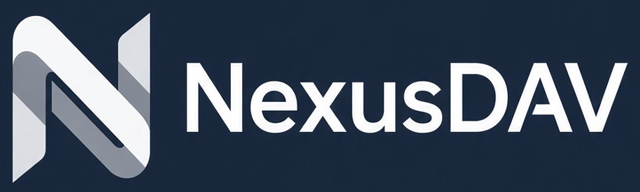

# NexusDAV



**Self-hosted CalDAV / CardDAV / WebDAV server** with a dedicated admin panel and user portal.

Built on top of the [sabre/dav](https://sabre.io/) PHP library.

**How is it different?** Unlike Radicale, Baïkal and standalone sabre/dav, NexusDAV comes with a full admin panel built on Filament (and a user portal from Version 2); unlike Nextcloud, it stays focused on calendars, contacts, tasks, notes and files instead of being a full groupware suite.

## Status

Version 1 is built, and the first three Version 1.x milestones are out (multilingual admin panel, reliable sync and sharing of calendars and address books): the current release is `0.3.0` (first release `0.1.0`). The repository contains a FrankenPHP container, `/health`, the first admin, and user, principal, and app-password management. `/dav/` accepts an app password and serves only that user's own data. Creating a user also creates that user's calendar home (`/dav/calendars/<username>/`) and address book home (`/dav/addressbooks/<username>/`), each with a default collection (`default`). The admin panel lists, creates, edits, and deletes calendars and address books for a user. A client discovers them from `/dav/`. The panel also has a Dashboard, Settings and Configuration pages (DAV services, time, rate limits, sessions), and a Diagnostics page with failed logins, DAV errors and every app password. The panel is available in English and Russian: each admin picks a language in the user menu, and the Configuration page sets the server default. Every request is logged with an ID that also appears on Diagnostics. Images for amd64 and arm64 are published to `ghcr.io/offsyanka99/nexusdav`, and tested reverse-proxy configurations for Caddy, nginx and Traefik are in [docs/proxy](docs/proxy/). Sync passes automated tests with vdirsyncer and the python caldav client. DAVx5 and Thunderbird were tested by hand on 0.1.3 with the [client checklist](docs/testing/client-checklist.md). 0.1.4 fixes the one failure found, a calendar deleted and created again with the same name. Apple clients have not been tried yet.

NexusDAV is built for homelabs and small teams. It is not a mail, chat or office-document suite, and it is not a hosted multi-tenant service.

A few limits matter before you install:

- No user portal before Version 2. Until then, management goes through the admin panel.
- No email before Version 2.x. Emailed replies to invitations are never read.
- The database is chosen before the first start and cannot be switched afterwards in Version 1.
- Notes (VJOURNAL) show up only in a few clients.

Details, versions and the full roadmap are in the [guide](docs/guide.md).

## Quick start

1. Get the Compose files and create your environment file. The Compose files pull the published image, `ghcr.io/offsyanka99/nexusdav:0.3.0`:

   ```bash
   git clone https://github.com/offsyanka99/NexusDAV.git
   cd NexusDAV
   cp .env.example .env
   ```

2. Edit `.env` and set at least:

   ```dotenv
   APP_URL=https://dav.example.com
   ADMIN_EMAIL=admin@example.com
   ADMIN_PASSWORD=change-me-to-a-long-random-password
   ```

   `ADMIN_PASSWORD` must be at least 12 characters. For PostgreSQL also set `DB_PASSWORD`. `APP_KEY` is generated on first start and stored on the data volume. Remove `ADMIN_PASSWORD` after the first login.

3. Start the server (pick one database; do not change it later):

   ```bash
   # PostgreSQL (recommended for production)
   docker compose -f compose.yaml -f compose.postgres.yaml up -d

   # or SQLite (simple deployments and development)
   docker compose -f compose.yaml -f compose.sqlite.yaml up -d
   ```

   To build the image from the checkout instead, add `-f compose.build.yaml` last and `--build`.

   **TrueNAS SCALE:** install as a Custom App instead of running Compose by hand — see [docs/truenas/custom-app.sqlite.yaml](docs/truenas/custom-app.sqlite.yaml) or [docs/truenas/custom-app.postgres.yaml](docs/truenas/custom-app.postgres.yaml), explained in the [guide](docs/guide.md#installing-on-truenas-scale).

4. Open the admin panel at `http://localhost:8080/admin` (or your `APP_URL`) and create a user. That user gets a default calendar and address book; add more from the user page. Events, tasks and notes are written by a CalDAV client, not in the admin panel.

5. Put it behind an HTTPS reverse proxy: ready-to-use files for Caddy, nginx and Traefik are in [docs/proxy](docs/proxy/), explained in the [guide](docs/guide.md#reverse-proxy-and-well-known).

6. Connect a client with that user's **app password**, not the account password. Client steps and DAV URLs are in the [guide](docs/guide.md#client-setup-and-compatibility).

Lost the admin password? Reset it from the container shell, as described in the [guide](docs/guide.md#resetting-the-admin-password). There is no web page that sets it.

## Documentation

- [Guide](docs/guide.md) — requirements, configuration, clients, backup, troubleshooting and roadmap
- [Architecture](docs/architecture.md) — how Laravel, Filament and sabre/dav fit together (Version 1)
- [Data model](docs/data-model.md) — tables and relationships
- [DAV endpoints](docs/dav-endpoints.md) — sabre/dav paths used in Version 1
- [Implementation plan (v1)](docs/plans/implementation-plan-v1.md) — step-by-step PRs with effort levels
- [Implementation plan (v1.x)](docs/plans/implementation-plan-v1x.md) — milestones and PRs for the Version 1.x features
- [Plan for Version 2 and later](docs/plans/version-2-and-later.md) — features for 2.0, 2.x and beyond
- [Apps](docs/apps/README.md) — Calendar, Contacts, Tasks, Notes, Files and the admin panel

## Contributing

Bug reports, client compatibility reports, documentation fixes and code contributions are welcome. Please read [CONTRIBUTING.md](CONTRIBUTING.md) before opening a pull request.

## Security

Please do not report security vulnerabilities through public issues. See [SECURITY.md](SECURITY.md) for how to report them privately.

## License

MIT. Copyright (c) 2026 HummerSoft. See [LICENSE](LICENSE).
