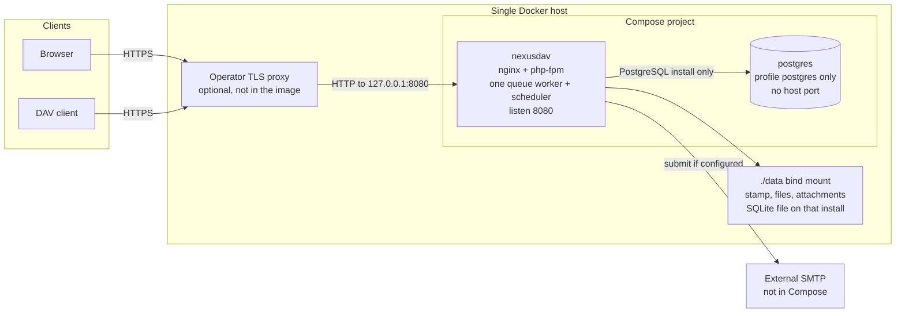
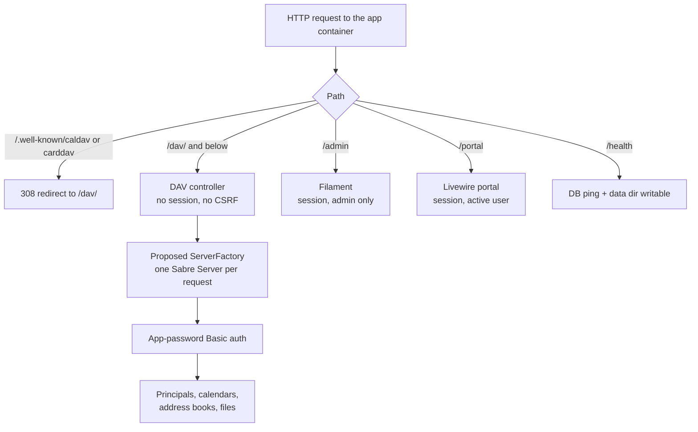
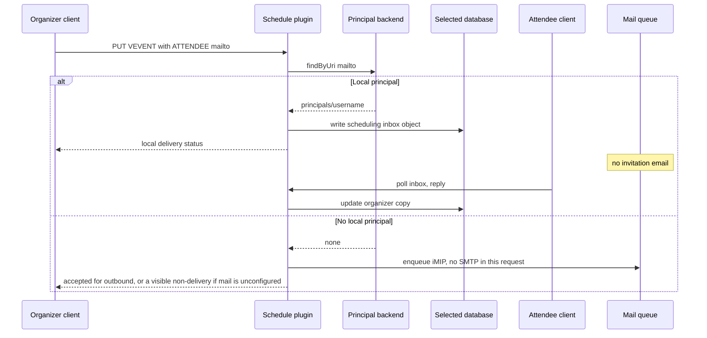
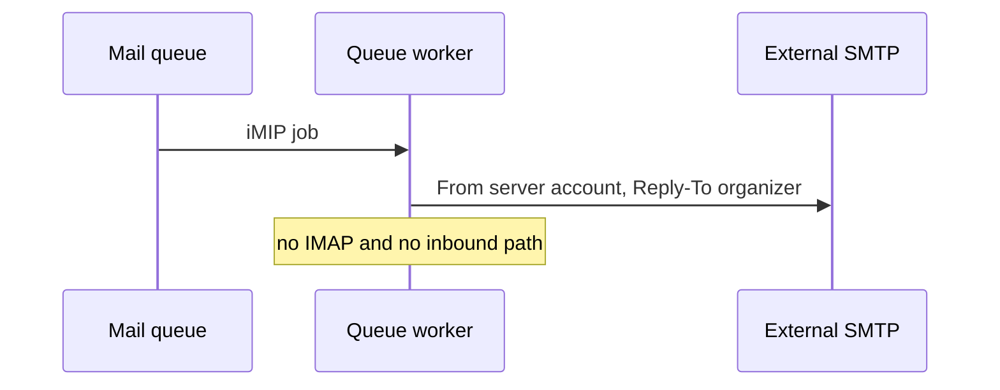
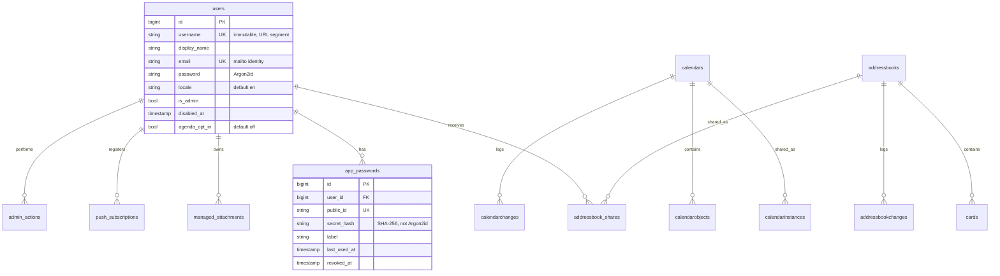

# NexusDAV High-Level Architecture

| | |
|---|---|
| **Author** | Architecture (draft) |
| **Date** | 2026-10-15 |
| **Status** | Draft |
| **Scope** | Single-node homelab CalDAV / CardDAV / WebDAV server |
| **Repository** | `/home/yurik/Documents/Dev/NexusDAV` |

This document is an architecture plan. It does not implement the system. Nothing described below exists in the repository yet unless it is explicitly called current state. Proposed modules are named so later work has stable seams; they are not classes to generate verbatim.

---

## Overview

NexusDAV is a self-hosted CalDAV, CardDAV, and WebDAV server for one household or small team, with a Filament admin panel and a separate Livewire user portal. Protocol behavior comes from [sabre/dav](https://sabre.io/). Identity, authorization policy for the UI, and both human interfaces come from Laravel.

The deployment is one Docker host and one application container. Before install, the operator selects PostgreSQL or SQLite; that choice cannot be changed afterward. A PostgreSQL install adds one database container. A SQLite install does not. Calendar objects, address-book objects, tasks, shares, sync tokens, and scheduling messages live in that selected database through sabre/dav’s PDO backends. WebDAV file bytes and CalDAV managed-attachment bytes live on the local Compose data volume. Humans authenticate with a session and an Argon2id primary password. DAV clients authenticate with HTTP Basic and a revocable app password that is not the primary password.

CalDAV scheduling in v1 still delivers invitations and free/busy between principals on this server. The server also sends mail through one external SMTP account: an attendee who is not a user here gets an outbound iMIP message only, and the same mailer carries account notices, `VALARM` email, and scheduled reports. Emailed replies are not read back. There is no mail server in Compose.

The repository today is a skeleton: `README.md` (product scope), `docker-compose.yml` (one unpublished image, host port 8080, bind mount `./data:/data`), `LICENSE` (MIT, copyright 2026 HummerSoft), and an empty `docs/plans/`. There is no `composer.json` and no application code.

---

## Background & Motivation

### Current state

`README.md` locks the product and the stack:

- Protocols: WebDAV, CalDAV, CardDAV, WebDAV-Push, principals and home collections, CalDAV scheduling, sync-token collection sync, CalDAV/CardDAV sharing plus ACL, managed attachments, and VTODO via CalDAV.
- Product: a lightweight self-hosted alternative to full groupware; admin UI; user portal; multilingual UI; Docker; standards-compliant DAV.
- Auth: Argon2id primary passwords; app passwords for DAVx⁵, Thunderbird, and similar clients.
- Stack: PHP, sabre/dav, Laravel, Filament (Livewire + Tailwind) for admin, Laravel + Livewire + Tailwind for the portal. Latest stable releases, pinned when introduced. License MIT.

`docker-compose.yml` today defines a single service `nexusdav` with `ports: "8080:8080"`, `volumes: ./data:/data`, and `restart: unless-stopped`. `image`, `build`, and `environment` are commented out. A top-level named volume `data` is declared and not mounted; the service uses a bind mount. There is no database service.

sabre/dav is a library, not a product. It does not ship an admin UI, Argon2id accounts, or app passwords. Its stock auth backend is HTTP Digest against a sabre `users` table, which cannot store Argon2id hashes. Its stock principal backend is a separate `principals` table. Those two stock backends are the wrong source of truth for this product. Its CalDAV and CardDAV PDO backends, including sync tokens, calendar sharing rows, and scheduling objects, are the right source of truth for protocol state. That split is the core design.

Two README protocols are not implemented inside current sabre/dav:

- **WebDAV-Push** is an in-progress draft (bitfireAT/webdav-push). The only widely deployed server implementation is a Nextcloud app. DAVx⁵ is the reference client. sabre has no push plugin. As of 2026-10-15 that repository has no tagged release. v1 enables the latest available commit, `611abe2e8a0cdd7570cb936844b6588f7145b27d` (`draft-bitfire-webdav-push-00`), and moves to a git tag or GitHub Release when one exists.
- **Managed attachments** (RFC 8607) are not a sabre plugin. Inline `ATTACH` inside an iCalendar object already works, because it is just calendar text in the selected database. Server-managed attachment bytes do not.

v1 still covers both, late in the build order, as small NexusDAV plugins on the seams below. Earlier milestones do not depend on them.

### Pain this avoids

A full groupware stack (mail, chat, file collaboration, multi-node object storage) is the wrong operational cost for 1–50 users. A bare sabre example server is the wrong product: Digest passwords, no UI, SQLite-shaped docs, and no separation between a browser session and a credential stored in a phone. NexusDAV sits between those: one host, one database, sabre for the wire protocols, Laravel for people.

---

## Goals & Non-Goals

### Goals

- One Compose project on one host that a homelab operator can back up, upgrade, and restore as a unit.
- A DAV client milestone as early as possible: discover a principal, then sync one collection type (calendars, including VTODO), before sharing, scheduling, push, or attachments.
- One identity per person, used by the admin panel, the portal, and DAV, without copying passwords into sabre’s Digest table.
- Protocol state that stays compatible with sabre’s PDO schema for the selected engine (`pgsql.*.sql` or `sqlite.*.sql`) for calendars, cards, sync changes, and scheduling objects.
- Sharing that is enforced by the same store the DAV stack reads, not by a second permission matrix in the UI.
- English as a complete UI locale, with the locale mechanism present so later translations are not an architecture change.
- Operability appropriate to a single tenant: stderr logs, a health check, and a documented backup of the selected database and `./data`.
- Outbound mail through one external SMTP account: iMIP for attendees who are not users of this server, account notices, `EMAIL` alarms on the event, and scheduled reports. Local attendees still get CalDAV delivery only.

### Non-goals

- A mailbox product, chat, or groupware beyond CalDAV, CardDAV, WebDAV files, and the outbound mail defined here.
- Contact sync by any protocol other than CardDAV.
- Inbound mail. No IMAP, no inbound webhook, no LMTP. Emailed accepts, declines, and counter-proposals are not read and are not written back into the event.
- A mail server in Compose, direct delivery to a recipient MX, or opening port 25 to the internet.
- A per-user SMTP account, or sending From each user’s own address.
- A second reminder system on top of the event’s own `VALARM`. `DISPLAY` and `AUDIO` alarms are client-side and send no mail.
- Emailing a local attendee an invitation that CalDAV already delivered on this server.
- An open relay. Nothing accepts mail from the internet or from a client for arbitrary forwarding.
- Multi-node deployment, Kubernetes, a load balancer, shared object storage, S3, or MinIO.
- Public SaaS and any isolation boundary between organizations. One deployment is one trust domain.
- Horizontal scaling, session affinity, or more than one app replica.
- External calendar subscriptions. Leaving `Sabre\CalDAV\Subscriptions\Plugin` unregistered is not enough to keep them off, because the calendar backend still implements `SubscriptionSupport`. The backend refuses `createSubscription` and lists none. The `calendarsubscriptions` table may exist if upstream DDL creates it. The server does not fetch a subscription URL.
- Cross-user sharing of WebDAV files. File homes are private in v1.
- Sharees re-sharing or transferring ownership.
- Group principals, room/resource principals, and Apple-style calendar-proxy delegation lists. Empty proxy principal nodes may still be synthesized so discovery does not 404.
- Per-recurrence-instance managed attachments.
- A full calendaring client in the browser (recurrence exceptions, time-zone editor, free/busy picker). DAV clients remain the primary editors of events and contacts.
- Two-factor authentication, app-password scopes, and anonymous or world-readable DAV.
- sabre’s HTML browser plugin.
- MySQL, and any database other than the PostgreSQL or SQLite engine selected at install.
- Changing database engines after install. v1 has no PostgreSQL↔SQLite migration, dump loader, or dual-write. A different engine is a new install on a new `./data` tree.
- Implementing any of this in the current task.

---

## Proposed Design

### Deployment topology

One Docker host. The app container always runs. A PostgreSQL install adds a postgres container. A SQLite install does not. No reverse proxy inside the app image.



**TLS.** The app speaks HTTP on port 8080. The operator terminates TLS in their own proxy (Caddy, Traefik, nginx, or similar) and forwards to the app. That proxy is not a NexusDAV component and is not started by Compose. DAV clients store the app password and should be configured with the `https://` URL the proxy serves. `APP_URL` is that external HTTPS origin. It is used for absolute managed-attachment URLs and for Laravel’s secure-cookie decision. v1 Compose publishes `127.0.0.1:8080:8080`, not `0.0.0.0:8080:8080` as the skeleton does today. Binding localhost forces a same-host proxy (or an SSH tunnel) and avoids cleartext Basic auth on the LAN by default. An operator who deliberately publishes 8080 on a trusted network is outside the recommended topology; the threat model treats that as cleartext credentials on the wire.

**How the skeleton grows.** Keep the service name `nexusdav`, the container port 8080, the restart policy `unless-stopped`, and the bind mount `./data:/data`. Fill in `build: .`. The app image includes both `pdo_pgsql` and `pdo_sqlite`. A PostgreSQL install adds a `postgres` service under Compose profile `postgres`: Compose network only, named volume for the database directory, required password from `.env`, pinned major, `pg_isready`. Do not publish `5432`. A SQLite install does not start that service and stores the database at `/data/database/nexusdav.sqlite`. Drop the unused top-level named volume `data`; it is not the volume the service mounts, and leaving it implies two data stores. Application environment (`DB_CONNECTION`, database identity, `APP_KEY`, `APP_URL`, trusted proxies) comes from an env file that is not an image layer. `DB_CONNECTION` is set before install and is not given a silent default.

**Process inside the app image.** nginx listens on 8080 and proxies to php-fpm on a Unix socket. Workers are not root. v1 uses a static FPM pool of 4 children. Do not run Laravel Octane or another long-lived worker model: a `Sabre\DAV\Server` and the PDO handle are built per request and must not survive into the next request.

FrankenPHP or nginx+php-fpm are both capable of serving this. nginx + php-fpm is the v1 choice because worker count and memory are explicit knobs, and a login’s Argon2id allocation stays on a normal short-lived worker. The image’s HTTP server is only the local listener behind the operator’s TLS proxy. It is not a second productized proxy.

**Database engine.** `DB_CONNECTION` is `pgsql` or `sqlite`, set in the env file before the install command. If it is unset, install refuses. There is no silent default. One install uses that one engine for Laravel tables and sabre PDO tables. They share one connection. MySQL is not supported. The app image includes both `pdo_pgsql` and `pdo_sqlite`.

The install command runs only against an empty database. It writes `/data/engine` once, a small stamp on the bind mount, not served by nginx, recording the engine and the database identity (SQLite absolute path, or PostgreSQL host plus database name). Boot reads that stamp first.

- Stamp missing and database empty: not installed yet. Install may write the stamp.
- Stamp missing but tables already exist: refuse to boot and do not recreate the stamp.
- Stamp present and env does not match: refuse to boot. Do not migrate, do not open the other engine, do not convert data.
- Pointing the env at a brand-new empty database while `/data/engine` names the old one is a mismatch and refuses. A new install is a new `./data` tree, not a conversion.

v1 has no PostgreSQL↔SQLite migration, dump loader, or dual-write.

**PostgreSQL install.** Official Postgres image, major tag pinned at implementation time (not `latest`), Compose profile `postgres`, no host port, named volume for the database directory, `pg_isready`. The postgres service is started only for this install. No SQLite file is created. sabre PDO uses the Laravel connection’s PDO handle, passed into the backends when the per-request server is built. There is no second DSN. Defaults for `max_connections` and memory are enough; v1 does not ship a custom Postgres tuning file.

That handle must use native prepares: `PDO::ATTR_EMULATE_PREPARES` false and `PDO::ATTR_STRINGIFY_FETCHES` false. Laravel’s base connector already defaults emulated prepares to false; this connection must not turn them on. Emulated prepares are a common workaround for pgBouncer transaction pooling, which v1 does not run, and they break sabre’s `BYTEA` writes. Upstream `pgsql` DDL types `calendarobjects.calendardata`, `schedulingobjects.calendardata`, and `cards.carddata` as `BYTEA`. sabre binds those values with `PDO::PARAM_LOB`. On sabre/dav 4.7.0 that binding throws `invalid input syntax for type bytea` for ordinary iCalendar (escaped commas, newlines) unless prepares are native, and 4.7.0’s bind was wrong even then. Release 4.7.1 (2026-07-07) fixes it: `#1623` (LOB binding for `BYTEA`) and `#1637` (`transparent` bound as an integer). The floor is `sabre/dav` >= 4.7.1, pinned in `composer.lock`. Do not rewrite those columns from `BYTEA` to `TEXT`, and do not drop the `PARAM_LOB` path to make an older sabre work.

**SQLite install.** App container only. The postgres service is not started. The database file is `/data/database/nexusdav.sqlite`. Every connection enables WAL, sets `busy_timeout` to 5000 ms, and sets `foreign_keys=ON`. The file is owned by the php-fpm user and is not world-readable. nginx still must not alias or root `/data`. sabre protocol tables use the column types in sabre’s sqlite scripts. Do not rewrite them to `TEXT`, and do not call them `BYTEA`. The same comma-and-newline PUT/GET round trip is required. Do not invent a second binding workaround. The same 1–50 user budget applies. SQLite has one writer. Four php-fpm workers queue on `busy_timeout` instead of running parallel writes. SQLite does not match PostgreSQL write throughput. Reads of a few requests per second remain inside the existing budget.

**Schema.** Laravel application tables go through the schema builder so the same migrations run on both engines. sabre protocol tables are applied from the SQL shipped with the pinned sabre version: `pgsql.*.sql` or `sqlite.*.sql`, chosen from the stamp. Do not apply PostgreSQL DDL to SQLite. The migration records which script and sabre version it copied.

**Capacity this topology is sized for.** 1–50 users, typically 2–4 devices each, so on the order of 200 DAV clients at the top of the range and far fewer in a household. The same budget applies to both engines. DAVx⁵-style polling every 15–30 minutes at ~10–30 requests per sync is on the order of a few requests per second if the clients line up, and well under 1 request per second when they do not. Budget for about 10 req/s sustained and a burst of a few dozen req/s during an initial sync. p95 on a LAN, as a design budget rather than an SLA: health under 50 ms; a small `PROPFIND` under 300 ms; a `calendar-multiget` of about 50 objects under 500 ms. An initial sync of 5,000 events should finish in under a minute because the client pages with sync tokens, not because one request returns the whole calendar. SQLite serializes writes: the four workers queue on `busy_timeout` rather than writing in parallel, so write throughput is lower than PostgreSQL. Read rates of a few requests per second stay inside this budget.

Storage, household typical: tens to a few hundred MB of database, 1–50 GB of files on `./data`. Heavy upper bound used for design, not as a quota product: about 1–2 GB of calendar and contact text (50 users × a few calendars × ~2,000 events × ~2 KB) plus sync-change rows, and tens of GB of files. On PostgreSQL that calendar and contact text lives in the database volume. On SQLite it lives in `/data/database`. File bytes stay on `/data/files` and `/data/attachments` either way. Argon2id still costs 64 MiB on a login. A PostgreSQL install keeps 2 GB as the comfortable RAM floor (Postgres on the same box). A SQLite install does not run Postgres; 1 GB is the comfortable floor.

### Request paths and HTTP surface



| Surface | Path | Credential | Who handles it |
|---|---|---|---|
| Discovery | `/.well-known/caldav`, `/.well-known/carddav` | none | Laravel. `308` to `/dav/` so `PROPFIND` is preserved. |
| DAV | `/dav/` | HTTP Basic, app password | sabre, via the adapter below. |
| Admin | `/admin` | Session, primary password, admin role | Filament. |
| Portal | `/portal` | Session, primary password, active user | Livewire. |
| Health | `/health` | none | Laravel. No user data, no secrets. |

`/dav` is not mounted at `/`. Filament, the portal, and DAV must not share a route tree. sabre’s base URI is `/dav/`.

There is no CSRF middleware and no session middleware on `/dav`. A stolen browser session must not be a DAV credential, and a DAV Basic header must not start a browser session. The DAV controller must return sabre’s status and body. It must not catch failures into Laravel’s HTML error page; clients will treat HTML as a corrupt calendar object.

`Sabre\DAV\Browser\Plugin` stays off. Humans use `/admin` and `/portal`.

### Laravel / sabre boundary

Laravel owns:

- The `users` row and the primary password hash.
- App passwords (issuance, hash, revocation, last-used).
- Sessions, CSRF, admin role, locale, and the decision “is this account allowed to open the UI”.
- UI routes and the services the UI calls to provision users and to change shares.
- Filesystem jail policy for `/data` (the mapping from principal to directory, quotas, and what may not be served).
- The WebDAV-Push subscription list and the later notifier (not sabre).
- Managed-attachment byte paths and the small metadata row that points at them.

sabre owns:

- WebDAV, CalDAV, and CardDAV method handling, XML, ETags, and status codes.
- The calendar, address-book, change, and scheduling tables, through its PDO backends.
- Sync-token arithmetic.
- Calendar share instances (`calendarinstances`) and CalDAV ACL evaluation on the wire.
- Local iTIP delivery into scheduling inboxes.
- VObject parsing. The portal uses `sabre/vobject` (already required by sabre/dav) when it reads or writes a task, event, or contact. It does not hand-edit iCalendar or vCard strings.

The integration boundary is three proposed pieces, and no others are allowed to call `Sabre\DAV\Server`:

1. **Server adapter** — proposed `ServerFactory`, invoked once per DAV request from a Laravel controller. It builds the tree, registers plugins, sets the base URI, and runs the sabre server against that request.
2. **Auth backend** — proposed class extending `Sabre\DAV\Auth\Backend\AbstractBasic`. One method matters: validate username plus secret. It does not use `Sabre\DAV\Auth\Backend\PDO` (Digest, HA1 hashes).
3. **Principal backend** — proposed class implementing `Sabre\DAVACL\PrincipalBackend\BackendInterface`, reading Laravel users. It does not use `Sabre\DAVACL\PrincipalBackend\PDO`.

UI code never instantiates a second sabre server to “do DAV internally”. It calls either a sabre backend method (`createCalendarObject`, `updateInvites`, and the CardDAV equivalents) or a proposed NexusDAV service that wraps those methods. Raw SQL against `calendarobjects.calendardata`, ETags, or sync-token columns is not allowed outside sabre’s backend. List screens may read display columns (`uri`, `displayname`, `componenttype`) with ordinary queries.

```php
// Proposed boundary. Not in the repository.
interface ServerFactory
{
    public function make(): \Sabre\DAV\Server;
}

// Auth, extending Sabre\DAV\Auth\Backend\AbstractBasic:
//   validateUserPass(string $username, string $password): bool
//   Success principal: "principals/{username}"
//   $password must be an app password. The Argon2id primary password
//   always fails here.

// Principals, implementing Sabre\DAVACL\PrincipalBackend\BackendInterface:
//   list and fetch from the users table
//   getPrincipalByPath returns {DAV:}displayname and
//   {http://sabredav.org/ns}email-address (lowercase, active users only)
//   updatePrincipal: display name only
//   searchPrincipals and findByUri("mailto:...") for local scheduling
//   group membership: empty in v1
// Home-set and schedule inbox/outbox URLs are injected by sabre plugins,
// not stored on this backend. See the principal contract.
```

**Plugins registered by the factory** (this is the architectural set, not a dump of every sabre class):

| When | Plugin or backend | README item |
|---|---|---|
| First DAV PR | `Sabre\DAV\Auth\Plugin` + app-password backend | Client auth |
| First DAV PR | `Sabre\DAVACL\Plugin` + principal backend | Principals, ACL |
| CalDAV PR | Proposed `CalendarBackend` extending `Sabre\CalDAV\Backend\PDO`, `Sabre\CalDAV\Plugin`, `Sabre\DAV\Sync\Plugin`. Subscribed MKCOL refused on this class. | CalDAV, VTODO, sync-token |
| CardDAV PR | Proposed `AddressBookBackend` extending `Sabre\CardDAV\Backend\PDO`, `Sabre\CardDAV\Plugin` (sync plugin already on) | CardDAV, sync-token |
| Files PR | Filesystem node under a jail, `Sabre\DAV\Locks\Plugin` with the PDO lock backend, property-storage PDO backend | WebDAV files |
| Sharing PR | `Sabre\DAV\Sharing\Plugin`, then `Sabre\CalDAV\SharingPlugin`. Both are required. Publish/unpublish is refused. | CalDAV sharing, including calendarserver clients |
| Scheduling PR | `Sabre\CalDAV\Schedule\Plugin` only. No mail in this PR. | On-server scheduling, free/busy |
| iMIP PR | Subclass of `Sabre\CalDAV\Schedule\IMipPlugin`. The stock class is not registered. `schedule` enqueues only for attendees who are not local principals, after local delivery. | Outbound iMIP |
| Attachments PR | Proposed managed-attachment plugin | RFC 8607, no per-instance |
| Push PR | Proposed push plugin advertising the draft token | WebDAV-Push |

Not registered: the stock `Sabre\CalDAV\Schedule\IMipPlugin` (it would call PHP `mail()` inside the request and would also email local users), `Sabre\DAV\Browser\Plugin`, the temporary-file filter (sabre’s own docs say not to use it on a real file tree), and `Sabre\CalDAV\Subscriptions\Plugin`. That last omission is not what blocks subscriptions; the backend contract below is. The iMIP PR registers a subclass instead; see Outbound mail. `Sabre\CalDAV\SharingPlugin` is registered, but its `publish-calendar` / `unpublish-calendar` action is refused and must not call `setPublishStatus(true)`.

**Package choice.** Do not take a dependency on `monicahq/laravel-sabre`. Its auth backend assumes Laravel has already authenticated the request, which is the session model we are deliberately not using for DAV. The request/response bridging idea is fine to reimplement in the one controller; the dependency is not.

### Backend instanceof contracts

`Sabre\CalDAV\CalendarHome` and the calendar nodes type-check the backend object. They do not read a wrapper flag. In sabre/dav 4.7.1:

- `getChild` / `getChildren` return `SharedCalendar` only when the backend is `instanceof Sabre\CalDAV\Backend\SharingSupport`. Otherwise they return a plain `Calendar`, and share invites never attach.
- Inbox and outbox are added only when the backend is `instanceof Sabre\CalDAV\Backend\SchedulingSupport`.
- `Sabre\CalDAV\Calendar::getSyncToken` and `getChanges` report no sync unless the backend is `instanceof Sabre\CalDAV\Backend\SyncSupport`.
- `Sabre\CardDAV\AddressBook::getSyncToken` and `getChanges` do the same for `instanceof Sabre\CardDAV\Backend\SyncSupport`.

The object stored on the calendar home is a proposed `CalendarBackend` that **extends** `Sabre\CalDAV\Backend\PDO`. Extension is what keeps those three `instanceof` checks true. A composing wrapper that only delegates fails them, so sync, sharing, and the schedule inbox disappear even if every method is forwarded. Do not use one.

The object stored on the address-book home is a proposed `AddressBookBackend` that **extends** `Sabre\CardDAV\Backend\PDO`, so it stays `instanceof SyncSupport`. Stock CardDAV PDO does not implement `SharingSupport`. `Sabre\DAV\Sharing\ISharedNode` is not a backend interface and is not what keeps sync. It lives on a proposed node that extends `Sabre\CardDAV\AddressBook`. The address-book home returns that node. `Sabre\DAV\Sharing\Plugin` looks the interface up on the node.

`CalendarBackend` is also `instanceof Sabre\CalDAV\Backend\SubscriptionSupport`, because a PHP subclass cannot drop an interface its parent implements. `Sabre\CalDAV\Subscriptions\Plugin` only maps the `{http://calendarserver.org/ns/}subscribed` resource type and the `source` element. It does not create collections and it does not fetch the URL. `CalendarHome` calls `createSubscription` from `createExtendedCollection` whenever the backend is `instanceof SubscriptionSupport`, and `getChildren` lists those rows. From the CalDAV PR on, the refusal is on `CalendarBackend` itself: `createSubscription` fails before inserting a row, and `getSubscriptionsForUser` returns an empty list. A subscribed MKCOL is rejected. Leaving the subscriptions plugin unregistered stays as a second step, not the switch. If upstream DDL creates `calendarsubscriptions`, keep the table. Stock sabre still does not server-fetch that URL; this is the non-goal, not an SSRF control.

Disabled accounts are overrides of the list and object methods on these two subclasses, added with sharing. They are not a second object around PDO. Object methods do not receive the HTTP caller. The override reads the authenticated principal from `Sabre\DAV\Auth\Plugin` on the per-request server. It rejects only when that principal has `disabled_at` set or the collection owner does. It does not require the authenticated principal to be the owner. `Sabre\CalDAV\Schedule\Plugin` calls these methods while the authenticated principal is the organizer and the calendar belongs to the attendee. An active organizer delivering into an active attendee’s calendar must pass. A disabled owner is still omitted from a sharee’s home and from direct object URLs. Share rows stay in the database and are served again only after re-enable.

### DAV tree

```text
/dav/principals/{username}/
/dav/principals/{username}/calendar-proxy-read/     empty in v1
/dav/principals/{username}/calendar-proxy-write/    empty in v1
/dav/calendars/{username}/{calendar-uri}/           VEVENT and VTODO
/dav/addressbooks/{username}/{addressbook-uri}/
/dav/files/{username}/...                           disk jail, private
```

Username is immutable in v1 and is stored lowercase, limited to a URI-safe alphabet (`a-z`, `0-9`, and a short allowlist such as `.`, `_`, `-`, length bounded). Display name and email may change. Email is compared lowercase and is the `mailto:` scheduling identity. The principal backend does not store home-set URLs. As long as the principal URL stays the two-segment path `principals/{username}`, `Sabre\CalDAV\Plugin` and `Sabre\CardDAV\Plugin` inject calendar-home-set and addressbook-home-set, and `Sabre\CalDAV\Schedule\Plugin` injects schedule-inbox-URL and schedule-outbox-URL. Clients discover collections from those properties rather than from hard-coded paths.

On-disk layout does **not** use the username:

```text
/data/files/{userId}/            WebDAV bytes for that principal
/data/attachments/{userId}/{id}  managed-attachment bytes, opaque file name
/data/tmp/                       scratch only; not part of the backup source of truth
```

`userId` is the numeric primary key. It is monotonic and guessable; it is not an access-control secret. Renaming a username is unsupported, but a future rename must not require moving trees or trusting a user-controlled string as a path segment. The file node maps `principals/{username}` to `userId` before any filesystem call. The control is the jail: after decoding, reject `..`, NUL, and backslash tricks; `realpath` must stay under `/data/files/{userId}`; do not follow a symlink that escapes. Only the app container mounts the volume, and nginx does not alias `/data`.

### Protocol mapping

| README protocol | v1 behavior | Where state lives |
|---|---|---|
| Principals and homes | Custom principal backend over `users`. Homes created when an admin creates the user, not lazily on first DAV login, so the portal can show empty collections immediately. | Laravel `users`. No sabre `principals` table. |
| CalDAV | `CalendarBackend` extends sabre CalDAV PDO, so `instanceof` `SyncSupport`, `SchedulingSupport`, and `SharingSupport` stay true. Not a composing wrapper. Default calendar `default` supports `VEVENT` and `VTODO`. Further calendars may restrict components. Subscribed collections are refused on this class. | Selected database: `calendars`, `calendarinstances`, `calendarobjects`, `calendarchanges`. |
| Tasks | Not a separate store. A task is a `VTODO` in a calendar. The portal’s task list queries objects with that component type. | Same calendar tables. |
| Sync-token | On for calendars and address books because `CalendarBackend` and `AddressBookBackend` remain `instanceof` the sabre `SyncSupport` interfaces, plus `Sabre\DAV\Sync\Plugin`. A wrapper that dropped those interfaces would make `getSyncToken` report nothing. Off for the file tree in v1. | `calendarchanges`, `addressbookchanges`, plus the `synctoken` columns. |
| CardDAV | `AddressBookBackend` extends sabre CardDAV PDO and stays `instanceof SyncSupport`. Default address book `contacts`. | Selected database: `addressbooks`, `cards`, `addressbookchanges`. |
| Sharing and ACL, calendars | `CalendarBackend` is still `instanceof SharingSupport`, so `CalendarHome` returns `SharedCalendar`. Access is the instance row: owner, read-only, or read-write (sabre stores these as access values 1, 2, and 3). | `calendarinstances` is the only share store. No parallel `calendar_shares` table. |
| Sharing and ACL, address books | CardDAV PDO does **not** implement `SharingSupport`. Share rows live in `addressbook_shares` and are applied by overrides on `AddressBookBackend`. `ISharedNode` is on the address-book node, not on the backend. Shared books appear in the sharee’s address-book home. | Proposed `addressbook_shares` table, Laravel-owned, plus the sabre card tables. |
| WebDAV files | Per-user home, Class 2 locks, dead properties. No cross-user ACL grants in v1. | Bytes on `/data/files/{userId}`. Locks and dead properties in the selected database (`locks`, `propertystorage` from sabre’s schema for that engine). |
| CalDAV scheduling | `Schedule\Plugin` on. Local principal match delivers into the attendee inbox. Free/busy is computed from local calendars only. | Selected database: `schedulingobjects`. |
| iMIP | Outbound only, after local delivery has run. A local principal gets inbox delivery and no invitation email. An unresolved `mailto:` is enqueued for the external SMTP account. The PUT does not open SMTP. Unconfigured mail is a visible non-delivery and is not queued. Emailed replies are not ingested. | Jobs on the selected database. The iTIP body is the message sabre already built. |
| Managed attachments | Late. Advertise `calendar-managed-attachments` and `calendar-managed-attachments-no-recurrence`. `POST` stores bytes, then updates the calendar object through the CalDAV backend so the sync token moves. The server never fetches a remote `ATTACH` URL. | Bytes on `/data/attachments/{userId}/{id}`. Metadata row in the selected database. The live `ATTACH` property also sits in `calendardata`. |
| WebDAV-Push | Late. sabre does not provide it. After a successful calendar or address-book mutation, NexusDAV emits a proposed in-process `CollectionChanged` event. Once PR 15 has landed, the notifier is on by default and sends a content-free Web Push ping to subscriptions for that collection. The event body is not the iCalendar or vCard. `DAV_PUSH` is a kill switch: off means do not advertise and do not send. | Subscriptions in the selected database, Laravel-owned. |

Inline base64 `ATTACH` inside an event remains valid calendar data and needs no attachment plugin. It counts against the calendar-object body limit, which is what pushes large files to managed attachments or to the file home.

**Scheduling flow.**



Until the iMIP PR, that else branch is still a local failure: nothing is queued and no socket is opened. The PR that adds the sender is the one that enqueues.

Inbound delivery has a second local requirement. `Sabre\CalDAV\Schedule\Plugin` sets `schedule-default-calendar-URL` to the first calendar in the home that the recipient owns (shared instances are skipped) and that supports `VEVENT`, or whose supported-calendar-component-set is absent. It does not look at `schedule-calendar-transp` for that choice. Transparency only changes free/busy. If the property is missing, delivery stops with scheduling status `5.2` (`Could not find a schedule-default-calendar-URL property`) and nothing is written to the inbox. Deleting `default` is allowed and must not recreate it. If that delete removes the user’s last owned `VEVENT` calendar, the portal says that on-server invites will not arrive until they create another one. A VTODO-only calendar does not satisfy this.

**Provisioning.** A proposed `UserProvisioner`, called from admin user-creation (not from the auth backend):

1. Insert the Laravel user.
2. Create the default calendar and default address book through the sabre backends.
3. Create `/data/files/{userId}/` writable by the PHP user in the container. The directory name is the numeric primary key and is guessable. The jail in the DAV tree section is what stops one principal from reading another’s files. The container is the only process that mounts the volume.

If step 3 fails, the whole create fails and the operator sees the error. Provisioning does not run again on login. If the owner deletes the default calendar, it stays deleted. The scheduling consequence is the `5.2` case above, not a new default calendar. Creating a user also enqueues the new-user notice once the account-notice PR has landed. That enqueue does not decide whether the user row is committed.

### Outbound mail

One external SMTP server. The app submits to it. It does not deliver to the recipient’s MX and it does not listen on port 25. Compose does not run Postfix or any other MTA. Settings live in the env file, not in the database and not in the image: host, port, encryption, username, password, From address, From name. Unlike the database engine, these may be changed later. A change is a restart, not a reinstall, and it does not touch `/data/engine`. If they are unset, the server still boots and DAV still works. Mail is then not sent, and the admin can see that mail is unconfigured.

One Laravel mailer and one database queue on the selected engine, the same PostgreSQL or SQLite database as everything else. A DAV `PUT` and a share action enqueue and return. They do not open an SMTP connection, and they do not roll back the calendar or share write when SMTP is down. One queue worker runs in the app container, beside nginx and php-fpm. The scheduler runs there too. There is no second container. On SQLite that worker is another writer, so there is a single worker and the existing `busy_timeout` of 5000 ms. A job retries a few times with backoff, then stays in the failed-job table for an admin to see. Logs record message type and recipient domain. They do not record the SMTP password, the iCalendar body, or a report body.

`/health` does not fail because SMTP is down or because mail is unconfigured. Those are admin-visible conditions, not a DAV outage.

Four message classes, all on that mailer:

1. **Invitations.** Local principal: CalDAV inbox only. Do not also email that user. Unresolved `mailto:`: enqueue iMIP. From is the server account. Reply-To is the organizer. The iTIP part is the calendar message sabre already built, plus a short plain-text English explanation. No user-authored HTML. While mail is unconfigured, the external attendee is a visible non-delivery: not a silent success, and not a job that can never leave. Local attendees are unaffected. Outbound invitation mail is capped at 50 messages per user per hour, counted on the selected database. Excess does not send and is visible. This is not an open relay.
2. **Reminders.** Every minute, the scheduler looks for a `VEVENT` `VALARM` whose action is `EMAIL` and whose trigger time has arrived. The trigger is evaluated in the event’s timezone. The fire instant is stored in UTC. A row records object UID, recurrence id, alarm identity, and that instant, so the alarm is sent once. If the server was down and the trigger is more than 15 minutes in the past, skip it and record the skip. Same From address. Recipients are the alarm’s `ATTENDEE`s, per RFC 5545. `DISPLAY` and `AUDIO` send no mail.
3. **Account notices.** Password reset is a one-time link, not the password. The admin can still set a password directly. The token lives in Laravel’s password-reset store on the selected database. When an admin creates a user, mail that user’s address a portal link and a set-password link. Do not include the password. When a calendar or address-book share is created, mail the sharee once, from the same share writer the UI and DAV already use, so a grant is not mailed twice. No mail on revoke.
4. **Reports.** An admin activity summary goes to admins only. Default daily, one setting on the selected database, and an admin can disable it. Counts and `admin_actions` lines only. No event bodies and no contact details. A user’s agenda is a digest of that user’s own events for the day. Opt-in, default off, English.

**External attendee, after the message is queued.**



The worker’s SMTP result is not written back onto the event. The scheduling status stored during the `PUT` means the message was accepted for the queue, or that mail is unconfigured. It does not mean the recipient’s server accepted it. A later SMTP failure remains a failed job.

**iMIP hook.** sabre/dav 4.7.1’s stock `Sabre\CalDAV\Schedule\IMipPlugin` listens for `schedule` at priority 120, which runs before `Schedule\Plugin::scheduleLocalDelivery`. `schedule()` calls PHP `mail()` inside the request for every `mailto:` recipient, local or not. It does not ask whether `findByUri` resolved. Its From is a configured sender and its Reply-To is the organizer, which matches the header rule here. The send path does not: it is synchronous, the body is only the iCalendar, and a local user would be emailed.

Do not register that class. Register a subclass that listens after local delivery. If the recipient is a local principal, or local delivery already succeeded, return without enqueueing. If the change is insignificant, send nothing, matching the stock gate. If the recipient is not local and mail is configured, enqueue and set the status to accepted-for-outbound. Do not open SMTP in the `PUT`. If mail is unconfigured, set a visible non-delivery status and do not enqueue. The plan’s rule is that behavior, not a hope that the stock plugin already does it.

**Disable and delete.** Disable sets `users.disabled_at`. The auth backend and the portal reject that principal, so their own app password and session stop working. That does not stop someone they had already shared with: stock `getCalendarsForUser` returns every `calendarinstances` row for the sharee, and the sharee’s app password still passes ACL on that instance.

The enforcement point is the disabled-account overrides on `CalendarBackend` and `AddressBookBackend` (see Backend instanceof contracts), used both for home listings and for object URLs. There is no wrapping filter. Share rows are kept so re-enable restores access without a new grant. They are not served while the owner or the authenticated principal is disabled.

- Listing omits a collection whose owner has `disabled_at` set. Listing a disabled principal returns nothing.
- Object methods do not take the HTTP user. The override reads the current principal from `Sabre\DAV\Auth\Plugin` and fails only when that principal or the collection owner is disabled. A URL cached before the disable fails like a missing share. An active organizer writing the attendee’s calendar during local scheduling is not rejected for not being the owner.
- The portal and `SharingService` go through these backends, so the UI cannot show what DAV will not serve.
- File homes have no sharees in v1. Auth rejection is enough for `/data/files/{userId}`.

Delete is rare, confirmed in the admin UI, and is not one cascade owned by the admin PR. The PR that introduces a store extends user-delete to that store. `calendarobjects` and `calendarchanges` have no principal column. They are keyed by `calendarid`, and every sharee’s `calendarinstances` row points at that same id. The owner is only the instance whose access is the owner value (`Sabre\CalDAV\Backend\PDO::deleteCalendar` already uses this split). A delete that joins object or change rows through every instance for the deleted principal wipes the owner’s events and sync log when an admin deletes a sharee. That is the same silent history drop this plan forbids for pruning, applied to a user who still exists.

| What user-delete removes | Rule | PR |
|---|---|---|
| User row | The account row. | PR 3 |
| `app_passwords` | Rows for this user. | PR 4 |
| Calendars this principal **owns** | Call sabre’s owner `deleteCalendar`. That removes the calendar, its `calendarobjects`, its `calendarchanges`, and every `calendarinstances` row for that `calendarid`, including sharees. | PR 6. Not `schedulingobjects`. |
| This principal’s **sharee** calendar instances | Delete only that principal’s non-owner `calendarinstances` row. Do not delete `calendarobjects` or `calendarchanges` for a `calendarid` they do not own. | PR 10. Those rows do not exist before sharing. |
| Address books this principal **owns** | `addressbooks.principaluri` is the owner. Remove the book, its `cards`, and its `addressbookchanges`. | PR 7 |
| `addressbook_shares` | Owner delete also removes shares of those books. Sharee delete removes only rows where they are the sharee, not the owner’s cards or change rows. | PR 11 |
| `/data/files/{userId}` | This user’s file home only. | PR 8 |
| `schedulingobjects` | Rows for this principal’s inbox. Not another user’s calendar objects. | PR 13 |
| `managed_attachments` and `/data/attachments/{userId}` | Rows and bytes together. | PR 14 |
| `push_subscriptions` | Rows for this user. | PR 15 |

Username is unique only among live users, and the principal path is `principals/{username}`. After the user row is gone the name can be issued again. Leftover sharee `calendarinstances` or `addressbook_shares` for that principal URI would be served to the new account. Sharee rows are therefore actually deleted, not left as tombstones. Owner delete already drops every instance of a calendar that is going away, which is the sabre owner path, not a sharee join.

PR 12 is the admin action that runs this split as it exists then: user, app passwords, owned calendars through sabre’s owner delete, sharee `calendarinstances` only, owned address books, `addressbook_shares` by the owner-versus-sharee rule, and the file tree. It does not delete `schedulingobjects`, `push_subscriptions`, or `managed_attachments`. Those three are added by PR 13, PR 15, and PR 14. A filesystem leftover is logged and is not a second source of truth. Deleting change rows is allowed only as part of sabre’s owner `deleteCalendar` for a calendar that is itself being removed. It is not allowed for a sharee, and it is not the sync-log prune this plan forbids.

### Sharing and ACL

Who may grant what:

| Actor | Grant | Limits |
|---|---|---|
| Owner of a calendar or address book | Read or read-write to another **active local** user, and revoke. | Cannot re-share. Cannot transfer ownership. Cannot share to an external URL. Cannot publish a world-readable collection. |
| Admin | Create and disable users. Set a new primary password (never display the old one). Create and delete any collection. Grant and revoke any share. Revoke any app password (never display the secret). | v1 admin UI does not render event, contact, or file bodies. An admin who needs content gets a normal share, same as anyone else. Admin DAV access is not implied by the admin role; it requires an app password, and ACL still applies. |
| Sharee | Use the collection at the granted level in DAV and in the portal. | Cannot change the share list, cannot delete the collection, cannot see other collections of the owner. |
| Disabled user | Nothing, including collections they had shared out. | Auth rejects the disabled principal. Overrides on `CalendarBackend` and `AddressBookBackend` hide their collections from sharees and reject object URLs, reading the principal from the auth plugin. An active organizer may still write an active attendee’s calendar. Share rows stay and are served again only after re-enable. |

Calendar sharing registers two plugins, in order: `Sabre\DAV\Sharing\Plugin`, then `Sabre\CalDAV\SharingPlugin`. sabre’s CalDAV sharing document says both are required. The generic plugin speaks draft-pot resource sharing, which is what many DAVx⁵ clients send. The CalDAV plugin advertises `calendarserver-sharing` and accepts the `calendarserver.org` `share` and `invite-reply` POSTs that Apple Calendar and older macOS/iOS clients send. Those POSTs and `SharingService` both end in sabre `updateInvites` and the `calendarinstances` rows. Registering only the generic plugin would leave Apple clients unable to share.

`Sabre\CalDAV\SharingPlugin` also handles `publish-calendar` by calling `setPublishStatus(true)`, which would create a world-readable URL. v1 refuses `publish-calendar` and `unpublish-calendar` (403) before that call. There is no public calendar URL and no anonymous principal. A proposed subclass, or an equivalent hook in the factory, is what refuses the action. Do not rely on “nobody will press publish”.

There is one writer for calendar shares: sabre `updateInvites` / the calendar instance rows, called from either sharing plugin on the DAV path and from a proposed `SharingService` on the UI path. Address-book shares have the same shape of service writing `addressbook_shares`. Laravel policies guard UI routes only (`admin` vs `self`). They are not a second ACL evaluated on `PROPFIND`. If a policy and a sabre ACL ever disagree, the sabre store wins for data access and the bug is in the UI service. The disabled-account overrides are not a second share store and are not an owner-only check; they only hide rows whose owner or authenticated principal is disabled.

### UI responsibility

**Admin (Filament).** Users, collections, shares, app-password revocation, audit log of admin mutations (actor, action, subject, time — a table or an equivalent structured log, not a SIEM). English strings in v1. No item-body browser.

**Portal (Livewire).** Account, locale, primary-password change, app-password lifecycle, collection create/rename/delete, share panel, file-home usage (not a full file manager; clients do file editing). Item editing is deliberately narrow and always a whole-object replace through the sabre backend:

- Tasks: summary, status, due.
- Events: summary, start, end, description, and only when the object is non-recurring. Recurring events are listed and left to a DAV client.
- Contacts: formatted name, one email, one telephone.

Deleting a calendar goes through the same backend. If the calendar was the user’s last owned `VEVENT` calendar, the portal warns that on-server delivery will fail with `5.2` until another one exists. It does not recreate `default`.

A month grid, a recurrence editor, and a full vCard editor are follow-on product work, not required for any DAV milestone.

### Body limits

| Kind | v1 default | Enforced by |
|---|---|---|
| WebDAV file PUT | 512 MiB | nginx `client_max_body_size` and a streaming file node. Not PHP’s memory limit. |
| Calendar or address-book object | 10 MiB | Adapter, even if nginx allows more. Rejects oversized inline base64 attachments. |
| Managed attachment | 25 MiB each, 2 GiB sum per user | Attachment plugin |
| WebDAV home total | No application quota. The disk is the limit. | Operator monitoring |

These are env-configurable defaults, not a quota subsystem.

The 512 MiB figure is the size on the wire, not the size PHP may buffer. sabre streams a PUT only if the node does not slurp the body into a string and `output_buffering` is `Off`. A default `memory_limit` of 128M aborts a buffered 512 MiB upload, so the published cap would be a lie. v1 requires all of the following:

- The file node streams the body to `/data/files/{userId}`.
- The app image sets `output_buffering=Off`.
- `memory_limit` is sized for one FPM worker plus one Argon2id login (256M is the v1 default). It is not raised to 512M to “support” the upload.
- nginx does not `alias` or `root` `/data`. The security section already forbids that; the files PR has to keep it true.

Calendar and card objects stay on the 10 MiB cap and may be buffered. They are not the streaming path.

### Internationalization

English (`en`) is the source locale and the only complete locale in v1. The mechanism ships with the admin panel:

- Laravel locale files (`lang/en.json` and PHP lang files) hold portal and app strings. Filament’s own translation set is used for the admin chrome.
- `users.locale` stores the preference. Session middleware calls `App::setLocale` for `/admin` and `/portal`. Fallback is `en`.
- The available-locale list is `en` until a translation change adds another entry. Adding a locale must not require a schema change.
- DAV is not localized. iCalendar, vCard, WebDAV XML, sabre exception text, and file names are stored and returned as the standards and the clients wrote them. The UI does not translate `SUMMARY` or `FN`.

### Sync-change retention

v1 does not prune `calendarchanges` or `addressbookchanges`.

`Sabre\DAV\Sync\Plugin` treats a `null` from the backend as “token expired, full resync”. The `SyncSupport` interface says an unknown or expired token must return null. Stock `Sabre\CalDAV\Backend\PDO::getChangesForCalendar` and the CardDAV twin do not implement that check. Given a token, they query `synctoken >= ?` and always return a delta. If no rows match, they echo the client’s token. Null is returned when the collection row itself is missing on an initial sync, not when a prefix of the change log was deleted. Deleting old change rows therefore drops history and lets the client advance past the gap. That is permanent divergence, not a full resync.

The upstream sabre DDL cannot express “older than 180 days” anyway. `examples/sql/pgsql.calendars.sql`, `pgsql.addressbooks.sql`, and the matching `sqlite.*.sql` scripts define those tables as `(id, uri, synctoken, calendarid|addressbookid, operation)` only. There is no timestamp. Adding one would be a schema fork of tables this design does not re-model, and a raw `DELETE` outside sabre is already disallowed.

At 1–50 users the change log is small next to calendar text, so leaving every row is the v1 choice. A later design may prune only if both of these exist: a wrapper around `getChangesForCalendar` / `getChangesForAddressBook` that returns null when the client’s token is strictly below the oldest retained `synctoken` for that collection, and a floor stored outside the sabre tables (those tables still have no age column). Until that wrapper exists, no command deletes from the change tables. PR 16 does not ship a prune.

---

## API / Interface Changes

There is no existing HTTP API. This is the v1 surface.

**Browser**

- `GET /health` → `200 {"status":"ok"}` or `503` if the selected database does not answer `SELECT 1` or `/data` is not writable.
- `GET|HEAD /.well-known/caldav` and `/.well-known/carddav` → `308` to `/dav/`.
- `/admin/*` Filament, session.
- `/portal/*` Livewire, session.
- Login rejects a disabled user. Session cookie is `HttpOnly`, `SameSite=Lax`, and `Secure` when `APP_URL` is `https`. Sessions are stored with Laravel’s `database` driver on the selected engine, not as files on the container writable layer.

**DAV**

- Everything under `/dav/` is sabre’s HTTP API (RFC 4918 and the CalDAV/CardDAV extensions the enabled plugins advertise). NexusDAV does not invent a parallel JSON API for clients.
- `OPTIONS` on a calendar home advertises CalDAV, sync, access-control, and — only once those PRs land — calendar-auto-schedule, sharing, and `calendar-managed-attachments` / `calendar-managed-attachments-no-recurrence`.
- WebDAV-Push’s `webdav-push` token is advertised only when the notifier is enabled. Once PR 15 has landed, `DAV_PUSH` defaults to on, so `OPTIONS` advertises the token. Setting the flag off is the kill switch: do not advertise and do not send.

**Auth backend contract**

- Realm: `NexusDAV`.
- Username is the immutable login name.
- Password is one app-password token. Issuance (PR 4) and DAV validation (PR 5) share one parser. Grammar:
  - `ndav_` + publicId + `_` + secret.
  - publicId is exactly 16 characters from `[0-9a-f]` (64 bits).
  - secret is unpadded base64url of 32 random bytes: 43 characters from `[A-Za-z0-9_-]`. That alphabet includes `_`. The token contains no `:`, so HTTP Basic’s `username:password` split is safe.
  - The only split is `^ndav_([0-9a-f]{16})_(.+)$`. Group 1 is the lookup key. Group 2 is the entire remainder and is the secret, including any `_` inside it. Do not split on every underscore. A token that does not match fails closed.
- Lookup is by that publicId, then `hash_equals` of `SHA-256(secret)` against the stored hash. The hash input is the secret substring, not the full token.
- The primary password never succeeds on this backend, even if it is correct.
- A disabled user never succeeds.
- `last_used_at` is updated on success without failing the request if the timestamp write fails.

**Principal backend contract**

- `getPrincipalByPath("principals/{username}")` returns `{DAV:}displayname` and `{http://sabredav.org/ns}email-address`. The email value is stored and compared lowercase. Disabled users are omitted.
- That sabre email property is what the sender side reads. `Sabre\CalDAV\Plugin` builds `calendar-user-address-set` from `Principal::getAlternateUriSet()`, which adds a `mailto:` only when `{http://sabredav.org/ns}email-address` is present. If the key is absent, `getAddressesForPrincipal` is empty and `Schedule\Plugin` emits no iTIP messages, even with `findByUri` implemented.
- calendar-home-set and addressbook-home-set are not fields this backend stores. `Sabre\CalDAV\Plugin` and `Sabre\CardDAV\Plugin` inject them for a two-segment `principals/{username}` URL. `schedule-inbox-URL` and `schedule-outbox-URL` come from `Sabre\CalDAV\Schedule\Plugin` on that same shape. Keeping any other principal path would silently drop those properties.
- `findByUri("mailto:…")` is the recipient lookup, via `Sabre\DAVACL\Plugin::getPrincipalByUri`. It matches an active user’s lowercase email only.
- `updatePrincipal` accepts display-name changes from DAV and writes `users.display_name`. It does not accept password or email changes from DAV. Email changes go through the portal so the scheduling identity is an explicit UI action.

**SharingService contract (proposed, used by portal and Filament)**

- `grant(actor, collection, shareeUser, read|read-write)`
- `revoke(actor, collection, shareeUser)`
- Actor is the owner or an admin. Sharee is a local active user. Implementation delegates to sabre `updateInvites` for calendars and to `addressbook_shares` for address books.

**CollectionChanged (proposed event)**

- Payload: collection URI, principal URI, time. No calendar body.
- v1 listeners: none, until the push PR. Mutations still go through the sabre backends, which are the place that emits the event after a successful commit.

---

## Data Model Changes

No database exists yet. This is the conceptual model, not DDL. Two owners, on purpose.



**Laravel is the source of truth for people.**

- `users` — one row per person. `is_admin` is enough; there is no role hierarchy in v1. The first admin is created by an operator-run install command, not by a password baked into the image or left in Compose for the life of the deployment.
- `app_passwords` — many per user. The secret is shown once at creation. Only `public_id` and `secret_hash` are stored. Revocation is `revoked_at`. v1 tokens are user-equivalent on DAV: they are not scoped to a single calendar. That matches what DAVx⁵ and Thunderbird expect, and it is an accepted limit.
- `addressbook_shares` — sharee principal, address book, access (`read` or `read-write`). This table exists only because CardDAV PDO has no instance table. It is the source of truth for address-book ACL.
- `managed_attachments` — owner, calendar-object UID, managed-id, byte size, media type, relative path under `/data/attachments`. The ICS `ATTACH` line is updated in the same request as the metadata insert. Bytes are written to a temp file and moved into place only after the calendar-object update succeeds; a crash leaves either the old object or a temp file, not a live ICS pointing at a missing id. An orphan sweep may delete files with no metadata row.
- `push_subscriptions` — user, collection URI, push endpoint, client encryption keys. Unused until the push PR.
- `admin_actions` — append-only audit of admin mutations.
- Laravel session table — standard session driver, not domain data.
- Laravel `jobs` and `failed_jobs` — the database queue on the selected engine. Not sabre tables. Invitation bodies sit in the job payload, not in the request log.
- Password-reset tokens — one-time reset and set-password links. The mail contains the link, not the password. The PR that adds them also removes a deleted user’s rows.
- Fired alarms — object UID, recurrence id, alarm identity, trigger instant in UTC, and whether it was sent or skipped. The PR that adds them removes rows for a deleted user’s objects.
- Agenda opt-in — `users.agenda_opt_in`, default off. The admin activity schedule is one setting on the selected database, default daily, not an env flag.

**sabre PDO is the source of truth for protocol objects.** Tables follow the DDL shipped with the pinned sabre/dav version for the stamped engine (`pgsql.*.sql` or `sqlite.*.sql`): `calendars`, `calendarinstances`, `calendarobjects`, `calendarchanges`, `schedulingobjects`, `addressbooks`, `cards`, `addressbookchanges`, `locks`, `propertystorage`. A Laravel migration applies that DDL, records which script it copied, and records the sabre version. Do not apply PostgreSQL DDL to SQLite. Those tables do not get Eloquent models. Upgrading sabre includes diffing that DDL. Migrations are forward-only.

On PostgreSQL, `calendarobjects.calendardata`, `schedulingobjects.calendardata`, and `cards.carddata` stay `BYTEA`, as in sabre’s `pgsql` scripts. They are not altered to `TEXT`. The PHP bind path is sabre >= 4.7.1 on a connection with native prepares, described under deployment. On SQLite, those columns keep the types in sabre’s sqlite scripts. They are not rewritten to `TEXT` and are not called `BYTEA`. Both engines require a PUT/GET round trip of a body that contains a comma and a newline. Change-log tables are not given a timestamp column and are not pruned in v1; see sync-change retention.

Not created from sabre’s auth/principal examples: sabre `users`, `principals`, and `groupmembers`. Identity is not stored twice. The `calendarsubscriptions` table is created only if dropping it would mean hand-editing upstream DDL. Rows are not inserted: `CalendarBackend::createSubscription` refuses, and `getSubscriptionsForUser` returns empty. Unregistering `Sabre\CalDAV\Subscriptions\Plugin` is extra, not the switch. `CalendarBackend` remains `instanceof SubscriptionSupport` because it extends PDO.

**Filesystem is the source of truth for bytes.** The selected database stores names, sizes, and the ICS pointer. It does not store file contents or attachment contents. The engine varies; the split between text and bytes does not.

**What is not a source of truth.** PHP sessions, `/data/tmp`, container writable layer, sabre’s in-memory server object, Filament’s UI state.

---

## Alternatives Considered

### How Laravel and sabre split

**Chosen.** Laravel owns identity, UI, and UI policy. One per-request server adapter, a custom Basic auth backend, and a custom principal backend. Calendars, cards, scheduling objects, and calendar shares use sabre’s PDO backends against the selected database. The UI writes protocol objects only through those backends.

**Stock sabre PDO for auth and principals as well.** Rejected. That backend is HTTP Digest and stores HA1 material, which cannot be Argon2id. It would be a second user directory with a second password, and the admin panel would be fighting the README’s auth model. sabre’s own docs point custom accounts at a custom principal backend, not at a subclass of the PDO principal backend.

**Eloquent backends that reimplement CalDAV and CardDAV.** Rejected. The user decision is that sabre data goes through the PDO backend. Reimplementing sync tokens, sharing instances, and scheduling support is the highest-risk code in the project and duplicates what `Sabre\CalDAV\Backend\PDO` and `Sabre\CardDAV\Backend\PDO` already do.

**Depend on `monicahq/laravel-sabre` as the adapter.** Rejected. It is a real Laravel bridge, and Monica shows the pattern, but its auth backend reads an already-authenticated Laravel user. That pulls DAV into the session guard or forces us to fake a login per Basic header. We would still write app-password validation and a principal backend. One in-app factory is a smaller, explicit seam for a single-node app. Revisit only if the bridging code (Symfony request to sabre HTTP) turns out larger than expected; that would not change data ownership.

### Where file bytes live

**Chosen.** Local filesystem on the existing `./data:/data` bind mount, subdivided into `files/` and `attachments/`. Operator-visible, trivial to back up with the Compose project, matches the skeleton, and matches the decision against object storage.

**PostgreSQL `bytea` or large objects for file bytes.** Rejected. Calendar and contact text stays in the selected database because it is small, structured, and the sabre PDO schema expects it there. File bytes and attachments are not: they bloat logical dumps and WAL, and WebDAV serving wants streaming reads and writes. A multi-gigabyte file home would make every database backup expensive for no protocol benefit.

**S3, MinIO, or any shared object store.** Rejected by the deployment decision. It adds a service and a credential, and it only pays off with more than one app instance. v1 has exactly one.

### Which database engine

**Chosen.** PostgreSQL or SQLite, selected with `DB_CONNECTION` before install and stamped in `/data/engine`. One engine for Laravel and sabre. The engine cannot be changed afterward.

**PostgreSQL only.** Superseded. An earlier decision locked sabre data to PostgreSQL and rejected SQLite. The operator replaced that: both engines are supported, the choice is made before install, and MySQL stays unsupported.

**Change engines later.** Rejected. v1 has no PostgreSQL↔SQLite migration, dump loader, or dual-write. Pointing an installed tree at the other engine, or at a new empty database while the stamp names the old one, refuses to boot. A different engine is a new install on a new `./data` tree. The engine is part of the install, not a later setting. *Decided by the operator.*

**SQLite file for sabre, Postgres for Laravel.** Rejected. One install uses one engine for everything. A split would be two databases and two backup stories, and boot would have to decide which store is authoritative. The stamp names one database identity.

### How mail is delivered

**Chosen.** Submit to one external SMTP account from a single queue worker in the app container. From is that account. Local scheduling stays on the server. Outbound iMIP is send-only.

**A mail server in Compose.** Rejected. Postfix, an MDA, or any MTA image is another service to patch and back up. The operator already has an external SMTP server. *Decided by the operator.*

**Direct delivery to the recipient’s MX.** Rejected. That opens port 25, takes on reputation and retry policy, and is not what a homelab host should do. Submission to the configured server is the only outbound path.

**Inbound iMIP.** Rejected for this version. Emailed accepts, declines, and counter-proposals are not read and are not written back into the event. No IMAP, no inbound webhook, no LMTP. *Decided by the operator.*

**Send as the user.** Rejected. One server account is the From address. Invitation messages set Reply-To to the organizer so a human reply reaches the organizer’s mailbox. The server does not ingest that reply, and it does not authenticate as each user. *Decided by the operator.*

---

## Security & Privacy Considerations

Trust boundaries:

1. **Outside the host.** Untrusted. TLS ends at the operator proxy.
2. **Proxy to `127.0.0.1:8080`.** The app assumes this hop is local. It does not implement TLS.
3. **Browser session vs DAV Basic.** Different credentials, different middleware, same underlying user id.
4. **App to the selected database.** PostgreSQL: Compose network, password auth, port not published. SQLite: the file `/data/database/nexusdav.sqlite` on the bind mount. It holds password hashes, app-password hashes, and calendar data, so it stays mode not world-readable, owned by the php-fpm user, and is never mapped by nginx.
5. **App to `/data`.** Same container mount. nginx must not alias `/data` as a static root. Only the file node reads it, after the jail checks.
6. **Single tenant.** Every admin is an admin of every user. There is no organization id to leak across, and no feature may add one “for later” without a new design.
7. **App to external SMTP.** Relay credentials are secrets in the env file. The app sends only mail it generated. It does not accept mail from the internet or forward a client-supplied message. Reply-To sends a human reply to the organizer’s own mailbox; the server does not ingest that reply.

Threat model for this shape:

| Threat | What the attacker gets | Response |
|---|---|---|
| Stolen app password | That user’s calendars, contacts, tasks, and files, until revocation. Not other users, unless this user was granted a share. | Token is user-equivalent by decision. Show-once, hashed, labeled, revocable, `last_used_at` visible in the portal. Primary password is a different secret, so rotating the login password does not by itself rotate client access; the portal has to say that. |
| Stolen primary password or session | Portal as that user. Admin session: user management, share changes, collection delete. Not an automatic DAV login. | Argon2id, session cookie flags above, regenerate session id on login, CSRF on UI routes, admin audit log. 2FA is out of scope. |
| Path traversal (`..`, encoding, symlinks) | Other users’ files or host files if the mount were broader. | Jail: resolve under `/data/files/{userId}` only; reject `..`, NUL, and backslash tricks; `realpath` must stay under that prefix; do not follow symlinks that escape; never interpolate username into a path. The numeric id is guessable and is not the control. Attachment reads use the opaque id, not the client file name. nginx does not alias `/data`. Container workers are not root. The image does not mount the Docker socket. |
| Share / ACL bug | Read or write of another principal’s collection, including a sharee still reading a disabled owner. | One share store per collection type; disabled-account overrides on the PDO subclasses hide a disabled owner or a disabled authenticated principal on both listing and object URLs, without treating “not the owner” as a deny (local scheduling delivery must still work); UI cannot write access flags except through `SharingService`; publish-calendar is refused; no anonymous principal; admin override is an explicit service path that writes an audit row; cross-user HTTP tests, including a disabled owner, are part of the sharing PRs. |
| Cleartext Basic | App password on the wire. | Recommended bind is localhost. `APP_URL` https. Document that publishing 8080 beyond the host without TLS is unsupported. |
| SSRF | Server fetches an attacker URL (attachment “import”, push endpoint). | v1 does not server-side fetch `ATTACH` URLs. The push PR, when it exists, may POST only to the subscription endpoint, HTTPS only, with a short timeout, and must refuse link-local, loopback, and metadata addresses. That PR does not widen v1 attachment behavior. |
| Credential leakage in logs | Replay of Basic, session, or the SMTP password. | Never log `Authorization`, cookies, password fields, SMTP passwords, or request bodies. DAV access logs are method, status, user id, path, duration. Mail logs are message type and recipient domain. |
| Backup theft | Full copy of calendars, contacts, files, and hashes. | Backups are as sensitive as the live data. App-password hashes are SHA-256 of 256-bit secrets, so the hash is not reversible and not guessable. Primary hashes are Argon2id. Losing `APP_KEY` invalidates sessions, not password hashes and not app-password hashes, because those hashes do not use `APP_KEY`. Still back up `.env`: Laravel encryption and any future encrypted column depend on it. |
| Online guessing of app passwords | Nothing practical. | Secret is at least 256 bits from `random_bytes`. Throttle is for noise: repeated failures on one `publicId` are slowed and logged, and they do not disable the user (a misconfigured client must not lock the account). |
| Admin browses private events out of curiosity | Contents the product did not need to show. | Admin UI has no item browser. Access is a share, which the owner can see. |
| Scheduling mail looks delivered when it is not | An organizer treats a queued or unconfigured invite as accepted by the recipient’s server. | The `PUT` status means accepted for the queue, or a visible non-delivery when mail is unconfigured. It does not mean SMTP accepted the message. Failed jobs stay visible. Local attendees are not also emailed. |

**Argon2id.** Primary passwords use PHP `password_hash` / `password_verify` with `PASSWORD_ARGON2ID`, via Laravel’s hash driver set to `argon2id`. Do not override `memory_cost`, `time_cost`, or `threads` in v1. PHP’s documented defaults apply (as of current PHP: `memory_cost` 65536 KiB, `time_cost` 4, `threads` 1). Interactive login is allowed to spend that cost; a target under about half a second on the homelab box is acceptable. If a future low-power host cannot meet it, changing the three parameters is an explicit decision, not a silent default.

**Why app passwords are not Argon2id.** Every DAV request would otherwise allocate ~64 MiB and run the Argon2 time cost. A handful of concurrent client bursts would compete with the 4 FPM workers and can push a 1 GB host into swap. The app password is a generated 256-bit secret, not a human passphrase, so a fast hash does not create a guessing attack. Store `hash('sha256', secret)` only.

**Install command.** The operator runs a console command to create the first admin. Compose does not contain a standing admin password. The command does not print the password into a persistent application log.

**Trusted proxies.** `TRUSTED_PROXIES` defaults to empty, so a client cannot spoof `X-Forwarded-Proto` on a mistakenly published port. When the operator binds localhost and runs a proxy on the same host, they set the proxy address (the Compose gateway, not `*`). Secure cookies follow that.

**Privacy of protocol data.** Calendar and contact bodies are not metrics, not log fields, and not admin-dashboard samples. Health output is a status flag.

---

## Observability

Homelab scale: Docker logs and a healthcheck. No Prometheus, no paging integration, no multi-region telemetry in v1.

- **Logs.** Laravel log channel to stderr, so `docker compose logs` is the operator interface. Default level `info`. `debug` is an env switch. One line per DAV request: method, status, authenticated user id (not username in the same line as a failed secret), path, duration in milliseconds. One line per UI login failure, without the password. Admin mutations also go to `admin_actions`.
- **Auth noise.** Repeated Basic failures for the same public id log at warning and are throttled. They do not page anyone; there is no alerter in the app.
- **Health.** `GET /health` runs `SELECT 1` on the configured connection and checks that `/data` is writable. Compose marks the app unhealthy otherwise. `pg_isready` exists only on the PostgreSQL install. The health body contains no DSN, no path listing, and no user count.
- **What the operator watches.** Container restarts (`unless-stopped` will loop a bad config; the restart count is the signal), disk full on the PostgreSQL volume when that engine is used and on `./data` (which holds the SQLite database on that install), and a burst of 401s after an app-password revocation (clients keep trying until the user updates them).
- **Not logged.** iCalendar bodies, vCards, file bytes, report bodies, `Authorization`, cookies, app-password tokens, primary passwords, SMTP passwords.
- **Mail.** An admin can see that mail is unconfigured, and can see the failed-job count. Neither condition fails `/health`. A mail log line is the message type and the recipient domain.

A metrics endpoint can be added later without changing the request path. It is not part of v1 because 10 req/s does not need a scraper to be operable.

---

## Rollout Plan

There is one environment: the operator’s host. “Staged rollout” means the order of merge and upgrade, not a cohort of tenants.

**Feature switches.** Env flags are kill switches, not a flag service. The PR that finishes a protocol sets that flag’s default to on. Setting it back to off hides the feature and does not migrate data backward.

- PR 13 sets `DAV_SCHEDULING` default on.
- PR 14 sets `DAV_MANAGED_ATTACHMENTS` default on.
- PR 15 implements `draft-bitfire-webdav-push-00` at commit `611abe2e8a0cdd7570cb936844b6588f7145b27d` and sets `DAV_PUSH` default on. `OPTIONS` advertises `webdav-push`. The flag remains a kill switch: off means do not advertise and do not send. Until that PR has merged, the code does not exist, so nothing advertises push. When a git tag or GitHub Release of bitfireAT/webdav-push is published, move off this commit onto that release. Until then, stay on this commit. Do not follow floating `main` in between.

**Mail.** SMTP settings may be empty at first boot. DAV does not wait for them. Until they are set, mail is unconfigured and nothing is sent; local CalDAV delivery still works. Filling them in is a restart, not a reinstall, and it does not touch `/data/engine`. The queue worker and the scheduler start with the app container once the mail-transport PR has merged. `/health` stays up when SMTP is down.

**Upgrade.** Pin the app image tag and, on a PostgreSQL install, the Postgres major tag in Compose. Pin PHP dependencies with `composer.lock`. Procedure: back up, pull the new app image, run forward migrations, restart the app container. Postgres major upgrades are a planned dump-and-restore, not an in-place image bump. The engine in `/data/engine` does not change during an upgrade.

**Rollback.** Application code rollback is the previous image tag **if** no non-reversible migration has run. Assume sabre DDL migrations are forward-only on both engines. If a migration has run and the new app is bad, restore the matching database snapshot and the `./data` archive, then start the previous image. Do not promise `migrate:rollback` across a sabre schema change.

**Backup (the actual recovery path).**

PostgreSQL:

1. Logical dump (`pg_dump` custom format) of that database, written outside the database volume. The database is not inside `./data`.
2. Archive of `./data` covering `files/`, `attachments/`, and the engine stamp. Exclude `tmp`.
3. A copy of `.env` (`APP_KEY` and the database password), stored with the same care as the dump.

Take the dump first, then the file archive. A restore uses a pair from the same window.

SQLite:

1. Stop the app, or take SQLite’s online backup, so the snapshot is consistent. A plain copy of a live WAL file is not a backup. No `pg_dump`.
2. Archive `./data`, which holds `database/`, `files/`, `attachments/`, and the stamp. Exclude `tmp`.
3. A copy of `.env` (`APP_KEY`), stored with the same care as the archive.

A torn managed attachment (ICS already pointing at a new id, bytes not yet copied, or the reverse) is acceptable at this size; the orphan sweep and a client re-upload fix it. Do not build a cross-store snapshot product.

**Restore.** Stop the app container, restore with the procedure that matches the stamp, start the app, hit `/health`, then have one client sync.

**First boot.** `DB_CONNECTION` is `pgsql` or `sqlite` in the env file. If it is unset, the install command refuses. The database is empty. The operator runs migrations and the install command, which writes `/data/engine`. Then they create users in `/admin`, each user creates an app password in `/portal`, and clients are pointed at `https://<proxy>/dav/` (or at the well-known URL).

---

## Risks

| # | Risk | Severity | Mitigation |
|---|---|---|---|
| 1 | Argon2id on the DAV hot path exhausts RAM under a client burst | High | SHA-256 for app passwords; Argon2id only for primary passwords; FPM pool capped at 4 |
| 2 | ACL or path bug exposes another user’s data, or a sharee keeps reading a disabled owner | High | One share writer per collection type; disabled-account overrides on the PDO subclasses (still `instanceof` the sabre support interfaces) on list and object URLs; filesystem jail; publish refused; cross-user tests in the sharing and files PRs, including a disabled owner; no anonymous DAV |
| 3 | Basic auth deployed without TLS | High if 8080 is reachable beyond the host | Publish `127.0.0.1:8080` only; TLS is the operator proxy; called out as unsupported otherwise |
| 4 | sabre upgrade changes PDO schema, or a sabre older than 4.7.1 / emulated prepares breaks PostgreSQL `BYTEA` writes | Medium | Floor `sabre/dav` >= 4.7.1; on PostgreSQL, native prepares and copy `BYTEA` DDL unchanged; on SQLite, copy the sqlite script’s column types unchanged; comma-and-newline PUT/GET on both engines in the calendar and card PRs; backup before migrate; forward-only rollback via restore |
| 5 | Two policy engines drift (Laravel policies vs sabre ACL) | Medium | Policies guard routes only; data access goes through sabre backends and `SharingService` |
| 6 | CardDAV sharing is custom because stock PDO lacks `SharingSupport` | Medium | Share rows on `addressbook_shares`; `ISharedNode` on the address-book node, not the backend; backend stays `instanceof SyncSupport`; smaller grant model (read / read-write, local users only); tests around home-set listing |
| 7 | WebDAV-Push draft moves or a client rejects the server | Medium | Implement commit `611abe2e8a0cdd7570cb936844b6588f7145b27d`; ship `DAV_PUSH` on so the server can be verified; keep the kill switch; switch to a release tag or GitHub Release when one is published; do not follow floating `main` in between |
| 8 | RFC 8607 is unused by many clients, and easy to implement wrongly | Medium | No per-instance attachments; inline `ATTACH` still works; size caps; fail closed across DB and disk |
| 9 | Queued mail is treated as delivered, or unconfigured mail looks like success | Medium | The `PUT` records accepted-for-queue or a visible non-delivery. It does not record SMTP acceptance. Unconfigured mail does not enqueue. Failed jobs stay visible to an admin. Local attendees still get inbox delivery and no invitation email. `/health` does not fail because SMTP is down |
| 10 | Database and file bytes restored from different times | Medium | PostgreSQL: paired `pg_dump` and `./data` archive. SQLite: one consistent `./data` snapshot (stop the app or use SQLite’s online backup); the database file and WAL are part of that snapshot, and a plain copy of a live WAL is not a backup. Attachment metadata is reparable; calendar text lives entirely in the selected database |
| 11 | Disk filled by the file home | Medium | Attachment quotas; no silent quota framework for general files; disk-full is an operator signal via Docker and the host |
| 12 | Principal URL tied to username, and someone later demands rename | Low | Username immutable in v1; display name is the mutable label; disk paths already use `userId` |
| 13 | Empty calendar-proxy nodes confuse delegation clients | Low | Nodes exist so discovery works; membership stays empty; delegation is an explicit non-goal |
| 14 | HTML error pages or the sabre browser plugin leak a second UI | Low | DAV controller returns sabre responses; browser plugin off |
| 15 | A prune of `calendarchanges` / `addressbookchanges` silently drops client history | High if a prune is added | Stock PDO echoes the client token on an empty delta instead of returning null. v1 does not delete those rows and does not add a timestamp column. A future prune requires the null-on-gap wrapper first |
| 16 | Boot with the wrong engine, or a new empty database while `/data/engine` names the old one | High | Stamp written once at install; boot refuses on mismatch and does not migrate or convert; unset `DB_CONNECTION` refuses install; a new install is a new `./data` tree |
| 17 | Reminders missed while the server was down | Medium | Scheduler every minute; a trigger more than 15 minutes in the past is skipped and the skip is recorded; a recorded fire is not sent again |
| 18 | SMTP credentials or invitation bodies in logs | High | Mail settings stay in the env file. Logs record message type and recipient domain only. No SMTP password, iCalendar body, or report body |

---

## Open Questions

There are no open questions.

WebDAV-Push is settled. PR 15 implements `draft-bitfire-webdav-push-00` at commit `611abe2e8a0cdd7570cb936844b6588f7145b27d`, enables the feature (`DAV_PUSH` default on), and moves to a git tag or GitHub Release when one is published. Until that release exists, stay on this commit.

Outbound mail is settled. One external SMTP account, send-only. Local attendees stay on CalDAV. External attendees get iMIP only, and emailed replies are not read back. Reminders are the event’s `EMAIL` alarm. Account notices and reports use the same mailer.

---

## References

- Repository: `/home/yurik/Documents/Dev/NexusDAV/README.md`, `/home/yurik/Documents/Dev/NexusDAV/docker-compose.yml`, `/home/yurik/Documents/Dev/NexusDAV/LICENSE`
- sabre/dav: https://sabre.io/ and https://github.com/sabre-io/dav
- sabre authentication backends: https://sabre.io/dav/authentication/
- sabre principals: https://sabre.io/dav/principals/
- sabre CalDAV and the PDO backend (`calendars`, `calendarinstances`, `calendarobjects`, `calendarchanges`, `schedulingobjects`): https://sabre.io/dav/caldav/
- sabre CalDAV sharing (both plugins required): https://sabre.io/dav/caldav-sharing/
- sabre WebDAV sync: https://sabre.io/dav/sync/
- sabre sharing: https://sabre.io/dav/sharing/ (`Sabre\DAV\Sharing\Plugin`, draft-pot-webdav-resource-sharing)
- sabre/dav 4.7.1 changelog (2026-07-07): `#1623` `BYTEA` / `PDO::PARAM_LOB`, `#1637` integer bind for `transparent`. Floor for this design.
- sabre property storage: https://sabre.io/dav/property-storage/
- sabre iMIP plugin (subclassed, not registered as stock): `Sabre\CalDAV\Schedule\IMipPlugin` in sabre/dav 4.7.1. `schedule` uses PHP `mail()` at priority 120, before local delivery.
- CalDAV managed attachments: RFC 8607
- WebDAV-Push draft and DAVx⁵ notes: https://github.com/bitfireAT/webdav-push at commit `611abe2e8a0cdd7570cb936844b6588f7145b27d` (`draft-bitfire-webdav-push-00`, the implementation target as of 2026-10-15; no releases or tags yet) and https://manual.davx5.com/webdav_push.html
- Prior art we are not building on: Baïkal and Davis (sabre-based servers, different admin and storage choices), `monicahq/laravel-sabre` (session-oriented Laravel adapter)
- PHP `password_hash` Argon2id defaults: PHP manual, `PASSWORD_ARGON2ID` and `PASSWORD_ARGON2_DEFAULT_*`

---

## Key Decisions

1. **Single-node homelab.** One Docker host, one app container, local disk, about 1–50 users. A PostgreSQL install adds one database container. A SQLite install is the app container only. No second app instance, no shared object storage, no load balancer. *Decided by the operator; this plan does not reopen it.*

2. **PostgreSQL or SQLite, chosen before install.** `DB_CONNECTION` is `pgsql` or `sqlite`, set in the env file before the install command. If it is unset, install refuses. There is no silent default. One install uses one engine for everything: Laravel tables and sabre PDO tables share that connection. There is no split. MySQL is unsupported. The choice cannot be changed afterward. The install command runs only against an empty database and writes `/data/engine` once (engine and database identity: SQLite absolute path, or PostgreSQL host plus database name). Boot reads the stamp first. A missing stamp with existing tables, or a stamp that does not match the env, refuses to boot: no migrate, no other engine, no conversion. A new empty database while the stamp names the old one is a mismatch. A new install is a new `./data` tree. v1 has no engine converter. *Decided by the operator.* The PostgreSQL half keeps `sabre/dav` >= 4.7.1, native prepares (`PDO::ATTR_EMULATE_PREPARES` false, fetches not stringified), and upstream `BYTEA` columns for calendar data, scheduling objects, and vCards, copied as-is and not rewritten to `TEXT`. The SQLite half uses the column types in sabre’s sqlite scripts, not rewritten to `TEXT` and not called `BYTEA`. Both engines require the comma-and-newline PUT/GET round trip. The app image includes `pdo_pgsql` and `pdo_sqlite`. PostgreSQL runs as a Compose profile `postgres` service (no host port, pinned major, `pg_isready`, named volume) and creates no SQLite file. SQLite is the app container only, database file `/data/database/nexusdav.sqlite`, WAL, `busy_timeout` 5000 ms, `foreign_keys=ON`, owned by the php-fpm user, not world-readable. SQLite has one writer; the four workers queue on `busy_timeout`. It does not match PostgreSQL write throughput.

3. **Local CalDAV delivery, plus outbound mail through one external SMTP account.** `Sabre\CalDAV\Schedule\Plugin` still delivers invitations and free/busy between principals on this server. An address that is not a user here gets an outbound iMIP message only. Emailed replies are not read and are not written back. There is no IMAP, inbound webhook, or LMTP, and no mail server in Compose. One SMTP account for the whole server, in the env file (host, port, encryption, username, password, From address, From name). From is that account. Invitation messages set Reply-To to the organizer’s email. The server does not send as each user. Unlike the database engine, these settings may change later: a restart, not a reinstall, and `/data/engine` stays untouched. If they are unset, the server still boots and DAV still works; mail is not sent, and the admin can see that. One Laravel mailer and one database queue on the selected engine. A DAV write or a share action enqueues and returns. It does not open SMTP and does not roll back when SMTP is down. One queue worker and the scheduler run in the app container. The stock `IMipPlugin` is not registered. A subclass enqueues only for non-local attendees, after local delivery. Reminders are the event’s own `EMAIL` `VALARM`. Account notices and the two reports use the same mailer. *Decided by the operator.*

4. **Bytes on the Compose volume, structured DAV objects in the selected database.** WebDAV files under `/data/files/{userId}`, managed attachments under `/data/attachments/{userId}/{id}`. Calendar, card, and scheduling text live in PostgreSQL or SQLite, whichever the stamp names. No S3 or MinIO. *Decided by the operator; the subdirectory layout is this plan’s decision.*

5. **Laravel owns people; sabre owns protocol behavior.** The only integration boundary is a per-request `ServerFactory`, an `AbstractBasic` app-password backend, and a principal backend over `users`. No sabre Digest `users` table and no sabre `principals` table. UI writes of calendar and card bodies go through sabre backend methods so ETags and sync tokens stay coherent. The calendar home is given `CalendarBackend`, a subclass of `Sabre\CalDAV\Backend\PDO`, not a composing wrapper, so `instanceof` `SyncSupport`, `SchedulingSupport`, and `SharingSupport` stay true. `SubscriptionSupport` is inherited; `createSubscription` refuses and `getSubscriptionsForUser` is empty. The address-book home is given `AddressBookBackend`, a subclass of CardDAV PDO, so `instanceof SyncSupport` stays true. `ISharedNode` is on the address-book node. Disabled-account overrides read the auth plugin’s current principal and reject only when that principal or the collection owner is disabled, so an active organizer can still deliver into an active attendee’s calendar.

6. **Do not depend on laravel-sabre.** Its auth model is “Laravel already logged the user in”, which is the wrong credential for DAV clients.

7. **No Octane.** Short-lived php-fpm workers, nginx on 8080 inside the image, TLS outside the image. Pool of 4. Publish `127.0.0.1:8080:8080`. Drop the unused Compose named volume `data`.

8. **Auth split.** Portal and admin: session plus Argon2id primary password at PHP’s default Argon2id parameters, via Laravel’s `argon2id` hash driver. DAV: HTTP Basic realm `NexusDAV`, app password only. Token grammar is `ndav_` + 16 hex chars + `_` + unpadded base64url of 32 bytes, parsed by one shared rule `^ndav_([0-9a-f]{16})_(.+)$` so a `_` inside the secret is not a second separator. Stored as SHA-256 of the secret substring, shown once, revocable, not scoped in v1. Primary password never works on `/dav`.

9. **Username is immutable and is the principal path segment.** Display name and email can change. Disk paths use numeric `userId`. Email is the `mailto:` scheduling identity.

10. **Calendar shares live only in sabre `calendarinstances`.** Address-book shares live in a Laravel `addressbook_shares` table because CardDAV PDO has no sharing backend. One `SharingService` is the UI writer. DAV sharing registers `Sabre\DAV\Sharing\Plugin` and then `Sabre\CalDAV\SharingPlugin`; publish/unpublish is refused so `setPublishStatus(true)` never runs. Disabled-account hiding is an override on the backend subclasses in decision 5, not a second share store; share rows stay. Sharees cannot re-share. Admins do not get a content browser.

11. **File homes are private in v1.** Locks and dead properties are in the selected database. No cross-user file ACL. No temporary-file filter. No collection sync on files.

12. **Tasks are VTODO components in CalDAV**, not a parallel task database. The portal edits a narrow field set; recurrence editing is out of scope.

13. **i18n.** English is the only shipped locale and the fallback. `users.locale` plus Laravel and Filament language files. DAV payloads are not translated. Extra locales are a translation change, not a design change.

14. **Push and managed attachments are in scope but last.** They are NexusDAV plugins, not stock sabre. Push rides a `CollectionChanged` event with a content-free notification. Attachments are whole-object, not per recurrence instance. Inline `ATTACH` works without that plugin.

15. **Provisioning is eager and admin-driven.** Creating a user creates the default calendar, default address book, and file directory. First admin comes from an install command, not from a standing Compose password. User-delete of each store is extended by the PR that introduces that store. Owner calendar delete goes through sabre’s owner `deleteCalendar` (objects, change rows, every instance). Sharee delete removes only that principal’s `calendarinstances` row, never the owner’s `calendarobjects` or `calendarchanges`. Address-book owner delete removes the book, cards, change rows, and its shares; sharee delete removes only their `addressbook_shares` rows. Those sharee rows are really removed, because a reused username would otherwise inherit them. PR 12 does not own `schedulingobjects`, `push_subscriptions`, or `managed_attachments`.

16. **Operability is backup-and-restore, not multi-region.** stderr logs, `/health`, forward-only migrations. PostgreSQL rollback restores a `pg_dump` and the `./data` archive (files, attachments, and the engine stamp); the database is not inside `./data`. SQLite rollback restores an `./data` archive taken while the app is stopped or via SQLite’s online backup, so `database/` (including the WAL), `files/`, `attachments/`, and the stamp are one consistent snapshot. A plain copy of a live WAL file is not a backup. `APP_KEY` is not an input to password or app-password hashes. Sync-change rows are not pruned in v1: stock sabre PDO would treat a deleted prefix as an empty delta and the client would skip history. No timestamp is added to those tables.

17. **Body limits.** 512 MiB file PUT, streamed to disk with `output_buffering=Off` and a `memory_limit` (256M) that is not the upload cap. 10 MiB calendar/card objects. 25 MiB and 2 GiB/user managed attachments. No general file-quota service. nginx does not alias `/data`.

18. **WebDAV-Push implements the latest available commit and ships enabled.** PR 15 implements `draft-bitfire-webdav-push-00` at commit `611abe2e8a0cdd7570cb936844b6588f7145b27d` (2026-05-01, “Add note for changing the endpoint (#101)”) and turns the feature on. `DAV_PUSH` defaults to on. `OPTIONS` advertises `webdav-push`. The operator needs this on to test and verify the server, including a subscription and a content-free notification after a calendar or address-book change. The env flag remains a kill switch: off means do not advertise the token and do not send notifications. The default is on, not off. Do not gate that default on a stable DAVx⁵ interoperability proof. Testing against a client (DAVx⁵, including its experimental push support since 4.4.10) is how the server is verified. The PR still includes that verification, but failure to finish a manual client check is not a reason to ship the flag defaulting to off. As of 2026-10-15 bitfireAT/webdav-push has no git tags and no GitHub Releases. When a tag or Release is published, move off this commit onto that release. Until that release exists, stay on `611abe2e8a0cdd7570cb936844b6588f7145b27d`. Do not follow floating `main` in between. SSRF limits on the push endpoint stay (HTTPS only, short timeout, refuse link-local, loopback, and metadata addresses). Until PR 15 has merged, the code does not exist, so nothing advertises push. That is sequencing, not a decision to ship the feature dark. When PR 15 merges, the feature is enabled. No release exists yet, and the server cannot be verified if push ships disabled. *Decided by the operator.*

---

## PR Plan

Each PR is meant to merge on its own and leave the tree deployable. Protocol work starts only after identity exists. A DAV client can succeed against principals plus calendars before any sharing, scheduling, push, or attachment PR.

### PR 1 — Compose database choice and Laravel app skeleton

- **Files / components:** `docker-compose.yml` (existing), proposed `Dockerfile`, nginx site listening on 8080, php-fpm pool of 4, Laravel application skeleton, `.env.example`, `.gitignore` entries for `.env` and `./data`, `GET /health`.
- **Depends on:** none.
- **Changes:** The image includes both `pdo_pgsql` and `pdo_sqlite`. Add the `postgres` service under Compose profile `postgres` (pinned major, no host port, named data volume, `pg_isready`). A SQLite install does not start that service and does not create a SQLite file until install; the database path is `/data/database/nexusdav.sqlite`. Point `nexusdav` at `build: .`, bind `127.0.0.1:8080:8080`, keep `./data:/data` and `restart: unless-stopped`, remove the unused top-level `data` volume. App container runs nginx + php-fpm as non-root, with the extensions Laravel and Filament need (`pdo_pgsql`, `pdo_sqlite`, `mbstring`, `intl`, and the usual Laravel set) plus Argon2 in the official PHP build. The pgsql connection sets `PDO::ATTR_EMULATE_PREPARES` false and `PDO::ATTR_STRINGIFY_FETCHES` false, so a later sabre `PARAM_LOB` bind is not stringified. PHP `output_buffering` is `Off`. nginx does not alias or root `/data`. Health runs `SELECT 1` on the configured connection and checks write access to `/data`, for both engines. `pg_isready` is only on the PostgreSQL install. No sabre, no Filament yet. Pin “latest stable” Laravel in `composer.lock` rather than floating a version in this design.

### PR 2 — Identity, Argon2id, sessions, first admin

- **Files / components:** Laravel `users` migration and model, `config/hashing.php` driver `argon2id` with PHP default costs, session driver `database`, login and logout for the future portal, proposed install command that creates the first admin only when the database is empty and writes `/data/engine`.
- **Depends on:** PR 1.
- **Changes:** Username rules (immutable, lowercase, URI-safe), unique email, `is_admin`, `disabled_at`, `locale` default `en`. Sessions use the Laravel `database` driver on the selected engine. Cookie flags as in the security section. `TRUSTED_PROXIES` empty by default. No DAV routes. The install command requires `DB_CONNECTION` to be `pgsql` or `sqlite`; unset refuses. It runs only against an empty database and writes `/data/engine` once, recording the engine and the database identity. A later boot whose env does not match the stamp refuses: no migrate, no other engine, no conversion. Tests: unset engine, first install, and a second boot with the other engine that must refuse.

### PR 3 — Filament admin shell and user management

- **Files / components:** Filament panel at `/admin`, admin gate, user resource, locale middleware, `lang/en` source files, `admin_actions`.
- **Depends on:** PR 2.
- **Changes:** Admin can create, disable, and delete users and set a new primary password. Delete cascade is only the user row at this point (no protocol data yet) and gains children in later PRs. Non-admins receive 403 on `/admin`. Available locales list is `en`. Filament chrome and app strings come from the English catalogs. No calendar UI yet.

### PR 4 — App passwords and portal shell

- **Files / components:** `app_passwords` table, proposed portal routes under `/portal`, app-password screens (create shows the token once, list labels, revoke).
- **Depends on:** PR 2. Lands cleanly after PR 3 so the portal and admin share the layout conventions, but it does not require Filament internals.
- **Changes:** Token grammar in the auth contract: `ndav_` + 16 hex chars + `_` + 43-character unpadded base64url secret. One proposed parser implements `^ndav_([0-9a-f]{16})_(.+)$` and is the only splitter; PR 5 calls it and does not reimplement the split. Store SHA-256 of the secret group only. Disabled users cannot open the portal. Copy in the UI states that DAV clients must use this token and not the login password. User delete, introduced in PR 3 for the user row, also removes this user’s `app_passwords`.

### PR 5 — DAV adapter, principals, discovery

- **Files / components:** proposed `app/Dav/ServerFactory.php`, `AppPasswordBackend`, `UserPrincipalBackend`, DAV controller, route `/dav`, well-known redirects, `sabre/dav` >= 4.7.1 pinned in `composer.lock`.
- **Depends on:** PR 4.
- **Changes:** Per-request sabre server, base URI `/dav/`, auth plugin, ACL plugin, principal tree including empty calendar-proxy nodes. Auth uses the PR 4 parser. `getPrincipalByPath` returns `{DAV:}displayname` and `{http://sabredav.org/ns}email-address` for active users. `OPTIONS` and current-user-principal work. Primary passwords fail. No calendar or file nodes yet. A client can authenticate and discover the principal. HTML error pages and the sabre browser plugin are absent. Integration test: valid app password, token whose secret contains `_`, wrong primary password, disabled user, well-known redirect.

### PR 6 — CalDAV, tasks, and sync tokens

- **Files / components:** migration applying sabre’s calendar DDL for the stamped engine (`pgsql.calendars.sql` or `sqlite.calendars.sql`, version-commented), `UserProvisioner` default calendar, proposed `CalendarBackend` extending `Sabre\CalDAV\Backend\PDO` wired into `Sabre\CalDAV\CalendarHome`, CalDAV plugin, sync plugin.
- **Depends on:** PR 5.
- **Changes:** The home receives the subclass, not a wrapper and not a bare `new PDO`. It stays `instanceof` `SyncSupport`, `SchedulingSupport`, `SharingSupport`, and, unavoidably, `SubscriptionSupport`. `createSubscription` refuses before insert, and `getSubscriptionsForUser` returns empty. `calendars/{username}/default` accepts `VEVENT` and `VTODO`. The migration copies sabre’s calendar DDL for the stamped engine and records the script and sabre version. On PostgreSQL, `calendardata` stays `BYTEA` and is not retargeted to `TEXT`, and the test asserts native prepares are still off. On SQLite, column types stay as in the sqlite script: not rewritten to `TEXT`, and not called `BYTEA`. Do not apply the PostgreSQL script to SQLite. The factory passes Laravel’s PDO. Sync-token collection sync works. Object body limit 10 MiB. This is the first real client milestone: DAVx⁵ or Thunderbird can create and sync a calendar and tasks. Tests cover, on both engines, PUT/GET of an object whose body contains a comma and a newline, with the GET bytes identical to the PUT; a second user receiving 403/404 on the first user’s calendar; a sync-token round trip; and a subscribed MKCOL (`{http://calendarserver.org/ns/}subscribed`) that is refused and writes no `calendarsubscriptions` row. User delete calls sabre’s owner `deleteCalendar` for calendars this principal owns. In this PR every instance is an owner instance, so that removes the calendar, its `calendarobjects`, its `calendarchanges`, and its instances. It does not delete object or change rows by joining every `calendarinstances` row for the principal, and it does not remove `schedulingobjects`. No retention prune of `calendarchanges`. Sharee-instance delete arrives in PR 10, when those rows exist.

### PR 7 — CardDAV

- **Files / components:** sabre CardDAV DDL for the stamped engine (`pgsql.addressbooks.sql` or `sqlite.addressbooks.sql`) in a migration, proposed `AddressBookBackend` extending `Sabre\CardDAV\Backend\PDO`, address-book home in `ServerFactory`, default `contacts` book in `UserProvisioner`.
- **Depends on:** PR 6 (same factory and provisioner; sequenced to avoid an empty merge conflict, not because of a data dependency beyond principals).
- **Changes:** The home receives the subclass so it stays `instanceof Sabre\CardDAV\Backend\SyncSupport`. Address-book CRUD on the wire and sync tokens. The migration copies the address-book script for the stamped engine and records the script and sabre version. On PostgreSQL, `cards.carddata` stays `BYTEA`. On SQLite, the column type stays as in the sqlite script and is not called `BYTEA`. Do not apply the PostgreSQL script to SQLite. The same cross-user denial test, the comma-and-newline vCard round trip (GET bytes match the PUT), and a sync-token round trip run on both engines. Still no sharing rows and no `ISharedNode` yet. User delete removes address books whose `principaluri` is this principal, and therefore their `cards` and `addressbookchanges`. It does not join cards through a share. No retention prune of `addressbookchanges`.

### PR 8 — Personal WebDAV files

- **Files / components:** proposed file-home node, jail helper, sabre locks and property-storage DDL from the matching engine script, `/data/files/{userId}` creation in `UserProvisioner` (that class arrives in PR 6), nginx body size 512 MiB, PHP `output_buffering` and `memory_limit`.
- **Depends on:** PR 6. Sequence after PR 7 so the tree is stable.
- **Changes:** Private file home only. The node streams the PUT body to disk and does not buffer it in a string. Confirm `output_buffering=Off`, `memory_limit` at 256M rather than at the upload cap, and no nginx alias or root of `/data`. Locks and property-storage DDL come from the stamped engine’s sabre script (`pgsql` or `sqlite`), not always the PostgreSQL file. Path-traversal tests (`..`, encoded dots, symlink escape). The numeric directory name is not treated as a secret. No cross-user grant. No sync-token on files. No temporary-file filter. User delete best-effort removes the directory.

### PR 9 — User portal for collections and narrow item edit

- **Files / components:** Livewire portal pages, proposed read/write services that call sabre CalDAV and CardDAV backend methods, `sabre/vobject` for VTODO/VEVENT/VCARD field updates.
- **Depends on:** PR 6 and PR 7. File usage display depends on PR 8.
- **Changes:** Collection lifecycle, task list (summary, status, due), narrow non-recurring event fields, narrow contact fields. Whole-object replace only. No month grid, no recurrence editor, no second permission table. Locale switcher writes `users.locale` and has only English to switch to.

### PR 10 — Calendar sharing and ACL

- **Files / components:** `Sabre\DAV\Sharing\Plugin` and `Sabre\CalDAV\SharingPlugin` registered in that order, publish POST refused before `setPublishStatus`, disabled-account overrides on `CalendarBackend` (not a wrapper), proposed `SharingService` for calendars, portal share panel, cross-user tests.
- **Depends on:** PR 6 and PR 9.
- **Changes:** Owner grants read or read-write to a local active user. Sharee sees the calendar in their home and in the portal. Sharee cannot re-share or delete the collection. Source of truth is `calendarinstances` only. `calendarserver.org` `share` is accepted; `publish-calendar` is 403 and creates no public URL. `CalendarBackend` stays `instanceof SharingSupport`, `SchedulingSupport`, and `SyncSupport` after the overrides, so `CalendarHome` still returns `SharedCalendar` and sync still works. Overrides read the current principal from the auth plugin and reject only a disabled principal or a disabled owner. They do not require the caller to be the owner. Rows stay. Sharee account delete removes only that principal’s non-owner `calendarinstances` row and does not delete `calendarobjects` or `calendarchanges`. Owner account delete still uses sabre’s owner `deleteCalendar`, which removes objects, change rows, and every instance of that calendar, including sharees. Both are required: username is unique only among live users, so a leftover sharee instance would be served to a later account with the same principal URI. Tests: sharee read, sharee write when read-only, non-sharee denied, one calendarserver `share` POST, one publish POST denied, disabled sharee denied, disabled owner omitted from the sharee’s home and rejected on the previously working object URL, and sharee-user delete leaves the owner’s objects and change rows in place while removing the sharee instance. The organizer-versus-attendee delivery case is asserted in PR 13, which merges after this PR so the assertion runs on a tree that already has these overrides.

### PR 11 — Address-book sharing

- **Files / components:** `addressbook_shares`, share and disabled-account overrides on `AddressBookBackend`, proposed node extending `Sabre\CardDAV\AddressBook` and implementing `Sabre\DAV\Sharing\ISharedNode`, address-book home returns that node, portal share panel reuse.
- **Depends on:** PR 7 and PR 10.
- **Changes:** Same grant rules as calendars. `ISharedNode` is on the node, not on the backend. `AddressBookBackend` stays `instanceof SyncSupport`. Disabled-account overrides match calendars: auth-plugin principal or owner disabled, not “caller must be owner”; share rows kept. Shared book appears in the sharee’s address-book home. DAV ACL matches the table. Owner delete removes the book, its cards, its change rows, and its `addressbook_shares`. Sharee delete removes only `addressbook_shares` rows where they are the sharee, not the owner’s cards or `addressbookchanges`, and those sharee rows are actually deleted so a reused username does not inherit the grant. Tests mirror PR 10, including a disabled owner and this owner-versus-sharee delete split.

### PR 12 — Admin collections and shares

- **Files / components:** Filament resources for collections and shares, `SharingService` admin path, `admin_actions` entries, user-delete cascade for identity, protocol rows, and the file tree.
- **Depends on:** PR 8, PR 10, and PR 11.
- **Changes:** Admin creates and deletes collections and grants or revokes shares without an item-body viewer. Delete-user runs the owner-versus-sharee split, not a join of `calendarobjects` or `calendarchanges` through every `calendarinstances` row for the principal. Deleting an owner calls sabre’s owner `deleteCalendar` (objects, change rows, every instance, including sharees) and removes address books they own (cards, change rows, and `addressbook_shares` for those books). Deleting a sharee removes only that principal’s non-owner `calendarinstances` row and `addressbook_shares` rows where they are the sharee. The same action also removes the user row, `app_passwords`, and `/data/files/{userId}`. It does not delete `schedulingobjects`, `push_subscriptions`, or `managed_attachments`. Test: after a sharee is deleted, the owner’s events and sync-change rows are unchanged, and the sharee instance is gone.

### PR 13 — On-server scheduling and free/busy

- **Files / components:** scheduling DDL if not already applied with the calendar schema, `Sabre\CalDAV\Schedule\Plugin`, `DAV_SCHEDULING` default on as a kill switch, portal copy for the last `VEVENT` calendar.
- **Depends on:** PR 10. PR 10 already includes PR 6 and PR 9, so the portal warning and the calendar milestone are in the tree. Scheduling can be developed against PR 6; it does not merge until PR 10 has landed. The organizer-versus-attendee assertion has to run on a backend that already contains the disabled-account overrides. The principal email-address property from PR 5 is required or no iTIP is emitted.
- **Changes:** This PR flips `DAV_SCHEDULING` from off to on. Setting it off unregisters the schedule plugin; it does not migrate. Local inbox delivery and free/busy from local opaque calendars. This PR does not send mail: the stock `IMipPlugin` is not registered, nothing is enqueued, and an unmatched `mailto:` is a local scheduling failure. Outbound iMIP is a later PR. Deleting the last owned `VEVENT` calendar is not undone; the portal warns, and a delivery attempt gets scheduling status `5.2` rather than a recreated `default`. User delete now also removes that principal’s `schedulingobjects`. Test: two local users, and the delivery still succeeds when the authenticated principal is the organizer and the calendar owner is the attendee (both active); one external address is not delivered locally and this PR enqueues nothing; a recipient with no owned `VEVENT` calendar; a disabled attendee receives nothing.

### PR 14 — Managed attachments

- **Files / components:** proposed attachment plugin, `managed_attachments` table, `/data/attachments/{userId}`, orphan sweep command, `DAV_MANAGED_ATTACHMENTS`, user-delete cascade extended to attachment bytes.
- **Depends on:** PR 6 and PR 8 (volume layout and body limits). PR 12’s delete-user is what this PR extends; sequence after PR 12 if both touch that cascade.
- **Changes:** This PR flips `DAV_MANAGED_ATTACHMENTS` from off to on and leaves the env var as a kill switch. Advertise `calendar-managed-attachments` and `calendar-managed-attachments-no-recurrence` only when the flag is on. `POST` writes bytes and updates the calendar object through the CalDAV backend. Caps: 25 MiB per file, 2 GiB per user. No remote URL fetch. No per-instance attachments. User delete now removes both the `managed_attachments` rows and `/data/attachments/{userId}`. PR 12 does not do this.

### PR 15 — WebDAV-Push seam and notifier

- **Files / components:** `CollectionChanged` emission after successful calendar and address-book commits, `push_subscriptions`, proposed notifier, `DAV_PUSH` default on. Target: `draft-bitfire-webdav-push-00` at https://github.com/bitfireAT/webdav-push commit `611abe2e8a0cdd7570cb936844b6588f7145b27d` (2026-05-01).
- **Depends on:** PR 6 and PR 7. This commit is the implementation target. Stay on it until a git tag or GitHub Release of bitfireAT/webdav-push exists, then move to that release. Do not follow floating `main` in between.
- **Changes:** Subscription storage and a content-free Web Push send to the client endpoint, with the SSRF limits in the security section. Payload is not the resource body. This PR sets `DAV_PUSH` default on. `OPTIONS` advertises `webdav-push`. The flag remains a kill switch: off means do not advertise and do not send. Until this PR has merged, the code does not exist, so nothing advertises push. When it merges, the feature is enabled. User delete removes that user’s `push_subscriptions`. Verification: subscribe, mutate a calendar or address book, and observe a content-free notification. That check uses a client such as DAVx⁵ (experimental push support since 4.4.10). An unfinished manual client check is not a reason to ship the flag defaulting to off. Do not gate the default on a stable DAVx⁵ release.

### PR 16 — Operability pass

- **Files / components:** DAV request logging, auth-failure throttle, backup and restore steps added to `README.md`, upload-limit check against nginx, the streaming file node, and PHP settings.
- **Depends on:** PR 5 at minimum. README backup section should land once the selected database and `./data` both exist (after PR 8). Can be split if review size demands it.
- **Changes:** No new protocol and no prune command. Nothing in this PR deletes from `calendarchanges` or `addressbookchanges`. Documents both backup procedures: PostgreSQL `pg_dump` plus an archive of `./data` (files, attachments, stamp), and a consistent SQLite snapshot of `./data` (database file and WAL, files, attachments, stamp). Confirms an operator can back up, restore, read logs, and see `/health` fail when the selected database is down or the SQLite file is missing. Does not add Prometheus or a second container. Does not add the mail worker; SMTP being down is not a health failure.

### PR 17 — Mail transport and worker

- **Files / components:** Laravel mail config from the env file, database queue on the selected engine (`jobs`, `failed_jobs`), one queue worker and the scheduler in the app container, admin-visible unconfigured and failed-job state.
- **Depends on:** PR 3. The admin panel is what shows the unconfigured and failed-job state. The queue itself uses the database from PR 1.
- **Changes:** SMTP host, port, encryption, username, password, From address, and From name come from the env file. Unset means the server boots, DAV works, and mail is not sent. Changing them is a restart and does not touch `/data/engine`. No Postfix and no second container. One worker. On SQLite it shares `busy_timeout` with the FPM workers. Jobs retry a few times with backoff, then remain failed for an admin. Logs are message type and recipient domain. `/health` does not check SMTP. No invitation, notice, reminder, or report is sent yet.

### PR 18 — Account notices

- **Files / components:** password-reset token store, new-user mail from admin create, password-reset mail from the portal.
- **Depends on:** PR 17 and PR 4. PR 4 is the portal that consumes the set-password link. Admin create already exists from PR 3.
- **Changes:** Password reset sends a one-time link, not the password. The admin can still set a password directly. Creating a user enqueues a portal link and a set-password link to that user’s email, and the user row commits even if SMTP is down. User delete removes that user’s reset tokens. No password in the message.

### PR 19 — Share-granted mail

- **Files / components:** enqueue on calendar and address-book grant, through the same share writer the UI and DAV use.
- **Depends on:** PR 17 and PR 11. PR 11 already includes calendar sharing from PR 10.
- **Changes:** A new share mails the sharee once. Revoke sends nothing. A failed SMTP submission does not roll back the share row.

### PR 20 — Outbound iMIP

- **Files / components:** subclass of `Sabre\CalDAV\Schedule\IMipPlugin`, invitation job, per-user hourly cap.
- **Depends on:** PR 13 and PR 17. Local delivery and the principal email property are already in the tree.
- **Changes:** The stock plugin is not registered. The subclass runs after local delivery and enqueues only when the attendee is not a local principal and the change is significant. The `PUT` does not open an SMTP socket. From is the server account. Reply-To is the organizer. The body is the iTIP message sabre built plus a short plain-text English explanation. Unconfigured mail is a visible non-delivery and enqueues nothing. Over 50 invitation messages per user in an hour does not send and is visible. Local users get no invitation email. Test: no socket during the `PUT`, one queued message afterward for an external attendee, and no invitation email for a local attendee.

### PR 21 — VALARM email

- **Files / components:** minute scheduler, fired-alarm rows, `EMAIL` alarm job.
- **Depends on:** PR 17 and PR 6. The events are already in the calendar tables. Scheduling is not required to read a `VALARM`.
- **Changes:** Once a minute, evaluate `VEVENT` `VALARM` actions of `EMAIL` in the event’s timezone and store the fire instant in UTC. Record UID, recurrence id, alarm identity, and that instant. Send once. A trigger more than 15 minutes in the past is skipped and the skip is recorded. Recipients are the alarm’s `ATTENDEE`s. `DISPLAY` and `AUDIO` send nothing. User delete removes fired-alarm rows for that user’s objects.

### PR 22 — Scheduled reports

- **Files / components:** admin activity schedule and its on/off setting, user agenda opt-in, both jobs on the same mailer.
- **Depends on:** PR 17, PR 3, and PR 6. Admin actions exist from PR 3. Agenda events exist from PR 6.
- **Changes:** Admin summary defaults to daily and can be disabled. It is counts and `admin_actions` lines to admins only. No event bodies and no contact details. User agenda is opt-in, default off, English, and lists that user’s own events for the day.
